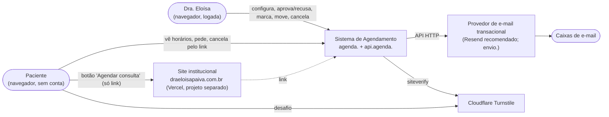
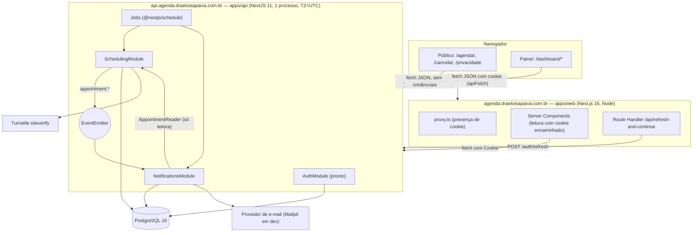
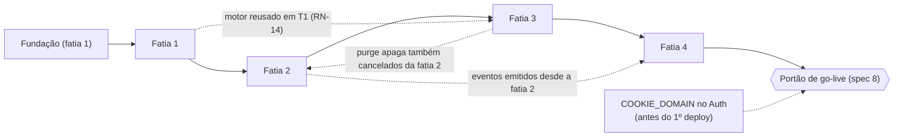

# Arquitetura — Agenda e Agendamento

Status: proposta, alinhada em 2026-10-28 com a spec
`docs/superpowers/specs/2026-10-28-agenda-e-agendamento-design.md` (a **spec**; versão
revisada depois das respostas do usuário/cliente). Este documento diz **onde** e **como**
cada regra é implementada; **o quê** (regras, transições, critérios) é a spec. Regras são
citadas pelo id (`RN-xx`, `T1`–`T14`, `CA-x.y`), sem reescrever o texto.

Base conferida no código em 2026-10-28:

- `apps/api`: NestJS 11.2.3, Prisma 6.19.3, Jest 30.
- `apps/web`: Next.js 16.3.3, React 19.2.8, Tailwind 4, shadcn com `@base-ui/react`.
- `packages/shared-types`: só `export {}` + `zod@3.25.76`.
- Postgres 16.15 via `docker-compose.yml`.

ADRs em `docs/decisions.md`: 001–019 aceitas; 020 (spec, com a atualização da 018) e
021–035 propostas. Decisões novas deste documento estão marcadas **(ADR-C n)** e listadas
na [seção 13](#13-candidatas-a-adr), com o número da ADR correspondente.

Guia prático (comandos, receitas, testes, DoD):
[`guia-de-desenvolvimento.md`](guia-de-desenvolvimento.md).

---

<a id="1-visao-geral"></a>
## 1. Visão geral

### 1.1 Contexto (C4 nível 1)



<a id="1-2-conteineres"></a>
### 1.2 Contêineres (C4 nível 2) e topologia (spec 9.9)



| Item | Decisão (origem) | Consequência para o código |
|---|---|---|
| Hosts | web em `agenda.`, API em `api.agenda.`, e-mail em `envio.` (spec 9.9) | `NEXT_PUBLIC_API_URL=https://api.agenda.draeloisapaiva.com.br`, `WEB_BASE_URL=https://agenda.draeloisapaiva.com.br` |
| Cookie | `COOKIE_DOMAIN=agenda.draeloisapaiva.com.br` em `setAuthCookies` **e** `clearAuthCookies`; ausente em dev, onde fica host-only (spec 9.9, opção B) | Mudança pequena no `cookie.util.ts` do Auth; atualiza a ADR 018 |
| CORS | Uma origem: `https://agenda.draeloisapaiva.com.br` (spec 10.1) | `CORS_ORIGIN` já é obrigatório no boot |
| Mesmo site | O site institucional é "mesmo site" para `sameSite` (spec 10.1) | A regra de `Content-Type` do CSRF ([8](#8-seguranca)) é obrigatória, não opcional |
| Processo | Um processo da API, sempre ligado (jobs) | Rate limit em memória e "último run" dos jobs não são compartilhados; hospedagem em aberto (spec 12, questão 7) |

Pontos fixos de ADRs existentes:

- Monolito modular orientado a eventos (ADR 003), com `scheduling` como fronteira única
  de consistência (spec 9.7).
- Cookies `sameSite: 'lax'` (ADR 018).
- UTC no banco (ADR 012) e regras de calendário no fuso da clínica (spec 9.1).

---

<a id="2-backend"></a>
## 2. Backend (NestJS)

<a id="2-1-modulos"></a>
### 2.1 Módulos e fronteiras

| Módulo | Responsabilidade | Pode depender de | Não pode |
|---|---|---|---|
| `AuthModule` (existe) | Login, refresh, guard global | `PrismaService` | — |
| `SchedulingModule` (novo) | Procedimentos, horário semanal, bloqueios, feriados e desbloqueios, motor de disponibilidade, pacientes, agendamentos, jobs de prazo/expiração e de expurgo, endpoints públicos | `PrismaService`, `common/*`, `EventEmitter2` | importar de `notifications/` |
| `NotificationsModule` (novo, fatia 4) | Ouvir `appointment.*`, gravar e enviar `Notification`, planejar lembretes | `PrismaService` (**só** tabela `Notification`), `common/*`, `scheduling/contracts/*` (eventos e `AppointmentReader`) | ler/escrever tabelas do `scheduling`; importar services/repos dele |
| `common/` (pasta) | Fuso/relógio, erros, filtro, validadores, `configureApp`, helpers de Prisma | — | regra de negócio |

**Porta de leitura `AppointmentReader` (ADR-C 8, conforme spec 9.7).** O `scheduling`
exporta, por `exports` do módulo, um provider somente leitura que devolve objetos simples
(sem tipos do Prisma):

- `getSnapshot(appointmentId)`: status, horários, `contactName`, `contactEmail`, nome do
  procedimento, token, `rejectionMessage`, `suggestedStartAt`.
- `listConfirmedStartingBetween(from, to)`: para o lembrete.

O `notifications` só conhece esse contrato e os eventos. Uma regra de lint
(`no-restricted-imports`) limita os imports de `notifications/**` vindos do `scheduling` a
`scheduling/contracts/**`.

<a id="2-2-camadas"></a>
### 2.2 Camadas internas e layout de pastas **(ADR-C 1)**

```
apps/api/src/
  main.ts                         # configureApp(app) + listen
  app.module.ts                   # + EventEmitterModule, ScheduleModule (condicional), módulos novos
  common/
    configure-app.ts              # helmet, cookie-parser, CORS, ValidationPipe, trust proxy,
                                  #   filtro de erro, middleware JSON-only — main.ts E testes
    time/
      clinic-time.ts              # ÚNICO lugar que conhece fuso/Luxon (2.12)
      clock.ts                    # interface Clock, SystemClock, token CLOCK
    errors/
      domain-error.ts             # DomainError(code, details?)
      error-codes.ts              # código -> status HTTP (2.5)
      http-exception.filter.ts    # corpo padrão de erro
    prisma/
      prisma-errors.ts            # isOverlapViolation(), isUniqueViolation(err, target)
      advisory-lock.ts            # lockSchedule(tx, professionalId)
    http/
      json-only.middleware.ts     # CSRF por Content-Type (spec 10.1)
    validation/                   # IsBrPhone, NoControlChars, IsLocalDate (ano 1..9998), IsIsoInstant, IsMultipleOf, assertLocalRange(from, to, maxDays)
  scheduling/
    scheduling.module.ts          # exports: [AppointmentReader]
    contracts/                    # ÚNICA superfície vista por outros módulos
      appointment-events.ts       # nomes e payloads (2.4)
      appointment-reader.ts       # interface + tipos do snapshot
    domain/                       # TypeScript puro: sem @nestjs/*, sem @prisma/client
      availability.ts             # motor (RN-01..RN-09, RN-46)
      holidays.ts                 # clinicHolidays(ano): nacionais + BH + Carnaval (spec 9.4)
      appointment-rules.ts        # guardas T1..T13, prazos (RN-23..RN-26, RN-35, RN-50, RN-54)
      block-impact.ts             # afetados de um bloqueio, keepIds (RN-43)
      contact-edit.ts             # efeito no token (RN-38)
      manual-slot-warnings.ts     # avisos de encaixe (RN-34)
      purge-policy.ts             # elegibilidade do expurgo (RN-70)
      phone.ts                    # E.164 (RN-11, RN-15)
      cancellation-token.ts       # 256 bits (spec 10.4)
      intervals.ts, statuses.ts, types.ts
    application/                  # casos de uso: transação, lock, repos, domínio, eventos
      procedures.service.ts
      schedule-config.service.ts       # horário semanal, bloqueios (+ RN-43)
      holiday-overrides.service.ts     # RN-46
      availability.service.ts
      dentist-appointments.service.ts  # T2, T3, T4, T9, T11, T12, T13
      public-booking.service.ts        # T1
      patient-cancellation.service.ts  # lookup, T5, T5b, T10
      approval-deadline.sweeper.ts     # T6, T8
      appointment-purge.service.ts     # T14
      appointment-reader.service.ts    # implementa contracts/appointment-reader.ts
      professional-context.service.ts  # User -> Professional (spec 7)
    infra/
      appointment.repository.ts, schedule.repository.ts, patient.repository.ts,
      procedure.repository.ts, holiday-override.repository.ts
      appointment-read.repository.ts  # leitura mínima da fatia 1 (calendário/disponibilidade); a fatia 2 decide se vira a porta AppointmentReader (ADR-C 8) ou é absorvido por appointment.repository.ts
      captcha/                    # CaptchaVerifier (porta), TurnstileVerifier, FakeCaptchaVerifier
    http/
      dentist/                    # controllers autenticados
      public/                     # controllers @Public() — lista fechada (spec 7)
      dto/                        # class-validator (ADR 013)
      presenters/                 # nunca devolver linha do Prisma
    jobs/
      approval-deadline.job.ts    # a cada 5 min
      purge.job.ts                # diário 03:00 local
  notifications/
    notifications.module.ts
    domain/
      reminder-schedule.ts        # reminderDueAt(), isReminderDue() (RN-62, RN-63)
      notification-plan.ts        # evento -> kinds (RN-60, RN-61, coluna E-mail de T1..T14)
      retry-policy.ts             # backoff, 5 tentativas
      templates/                  # render(data) -> { subject, text, html }
        html.ts                   # tagged template que escapa por padrão
    application/
      appointment-events.listener.ts
      reminder-planner.service.ts
      notification-dispatcher.service.ts
    infra/
      email-sender.ts             # porta EmailSender (spec 9.6)
      provider.email-sender.ts    # produção (API HTTP do provedor)
      mailpit.email-sender.ts     # dev (API HTTP do Mailpit)
      fake.email-sender.ts        # testes (CA-4.20)
      notification.repository.ts
    jobs/
      reminder.job.ts             # a cada 15 min
      dispatch.job.ts             # a cada 1 min
```

| Camada | Pode importar | Testada por | Regra |
|---|---|---|---|
| `domain/` | outros arquivos de `domain/`, `common/time/clinic-time.ts` | **unit** (sem DB, sem Nest) | `now`, fuso e dados entram por parâmetro; nunca `new Date()`/`Date.now()` |
| `application/` | `domain/`, `infra/`, `common/`, `EventEmitter2`, `CLOCK`, `contracts/` | **integração** (Postgres real) | Dona da transação; `const now = this.clock.now()` uma vez por caso de uso; emite eventos **depois** do commit |
| `infra/` | `@prisma/client`, `common/prisma` | integração | Recebe `tx`; converte erro do Prisma em `DomainError`; sem regra |
| `http/` | `application/`, `dto/`, `presenters/`, `common/` | **e2e** (supertest) | Valida, tira `professionalId` da sessão, chama um caso de uso, apresenta |
| `jobs/` | `application/`, `CLOCK` | integração (chama o caso de uso direto) | `@Cron` → `service.run(clock.now())` e nada mais |

Prisma não é mockado nos testes de `application/`: a correção depende de constraint, lock
e `UPDATE` condicional, que só existem no Postgres.

<a id="2-3-dominio-puro"></a>
### 2.3 Lógica pura de domínio (contratos)

Assinaturas indicativas; o que não muda é "dados entram, resultado sai, sem I/O".

```ts
// scheduling/domain/availability.ts — RN-01..RN-09, RN-13, RN-46; CA-1.1..1.4, 1.6..1.17, 1.23, 1.24
export interface AvailabilityInput {
  fromDate: LocalDate; toDate: LocalDate;            // 'YYYY-MM-DD' no fuso da clínica, inclusivos
  weeklyHours: { dayOfWeek: number; startMinute: number; endMinute: number }[];
  blocks: Interval[];                                // UTC, semiabertos
  occupied: Interval[];                              // só status ocupantes (statuses.ts)
  holidays: Map<LocalDate, string>;                  // clinicHolidays() dos anos do intervalo
  holidayOverrides: Set<LocalDate>;                  // RN-46: feriado desbloqueado = dia normal
  durationMinutes: number;                           // já resolvido (RN-04)
  now: Date;
  timeZone: string;                                  // 'America/Sao_Paulo'; outro nos testes (CA-1.17)
  gridStepMinutes?: number;                          // 30 (RN-02)
}
export function computeAvailableStarts(i: AvailabilityInput): Map<LocalDate, Date[]>;
export function isOfferableStart(i: AvailabilityInput, start: Date): boolean;   // RN-14

// scheduling/domain/holidays.ts — spec 9.4; CA-1.8..1.10
export function easterSunday(year: number): LocalDate;              // Meeus/Jones/Butcher
export function clinicHolidays(year: number): Map<LocalDate, string>; // nacionais + BH + seg/ter de Carnaval

// scheduling/domain/appointment-rules.ts — tabela da spec seção 5
export function approvalDeadline(startAt: Date): Date;              // startAt − 24h absolutas
export function isLastMinuteRequest(createdAt: Date, startAt: Date): boolean;   // RN-24
export function pendingOutcome(a: { createdAt; startAt }, now: Date)
  : 'OPEN' | 'APPROVAL_TIMEOUT' | 'EXPIRED';                        // RN-23, RN-25, RN-54 (ver 2.11)
export function effectiveStatus(a, now): { status; cancelReason? };  // lookup sem efeito colateral
export function assertCanApprove(a, now): void;                      // RN-26
export function assertCanReschedule(a, newStart, now): void;         // RN-31, RN-35
export function assertCanEditContact(a, now): void;                  // RN-38
export function patientCancelPath(a, now): 'T5' | 'T5b' | 'T10' | 'DENIED';  // RN-50, RN-54
// + assertCanReject, assertCanDentistCancel, assertCanMarkOutcome (T4, T11, T12)

// scheduling/domain/block-impact.ts — RN-43; CA-2.11, 2.12, 2.17
export function affectedByBlock(block: Interval, occupants, now): string[];  // PENDING/CONFIRMED com startAt > now
export function validateKeepIds(affected: string[], sentAffected: string[], keep: string[])
  : 'OK' | 'STALE' | 'KEEP_NOT_SUBSET';

// scheduling/domain/contact-edit.ts — RN-38; CA-2.19, 2.20, 3.31
export function tokenEffect(oldEmail: string | null, newEmail: string | null)
  : 'KEEP' | 'GENERATE' | 'ROTATE' | 'CLEAR';

// scheduling/domain/purge-policy.ts — RN-70, RN-71; CA-3.29
export const PURGEABLE_STATUSES = ['REJECTED', 'CANCELLED', 'EXPIRED'] as const;
export function purgeCutoff(now: Date): Date;                        // now − 7 dias absolutos

// notifications/domain/reminder-schedule.ts — RN-62, RN-63; CA-4.6..4.11, 4.16..4.18
export function reminderDueAt(startAt: Date, timeZone: string): Date;
export function isReminderDue(input: {
  status; contactEmail; startAt; now;
  reminderAlreadyPlanned: boolean;                  // existe dedupeKey reminder:{id}:{startAt}
  scheduleEmailAfterDue: boolean;                   // confirmed/direct_booking/rescheduled PENDING|SENT com createdAt ≥ dueAt
}, timeZone: string): boolean;
```

A máquina de estados é **guarda pura + `UPDATE` condicional**: a guarda dá a mensagem e o
teste unitário; o `WHERE` garante sob concorrência. Os dois calculam o limite de tempo com
a mesma função.

<a id="2-4-eventos"></a>
### 2.4 Contratos de evento

Arquivo único `apps/api/src/scheduling/contracts/appointment-events.ts`. Nomes da coluna
"Evento" da spec seção 5. Payloads **sem dado pessoal**: o listener lê o resto pelo
`AppointmentReader`.

```ts
export const AppointmentEvents = {
  Requested:      'appointment.requested',        // T1
  Confirmed:      'appointment.confirmed',        // T2, T3
  Rejected:       'appointment.rejected',         // T4
  Cancelled:      'appointment.cancelled',        // T5, T5b, T6, T7, T10, T11
  Expired:        'appointment.expired',          // T8
  Rescheduled:    'appointment.rescheduled',      // T9 (remarcar E redimensionar — evento único)
  ContactUpdated: 'appointment.contact_updated',  // T13 (nenhum e-mail)
} as const;
// T12 e T14 não emitem evento.

interface Base {
  appointmentId: string;
  auditEventId: string;     // AppointmentEvent.id da mesma transação — base do dedupeKey
  occurredAt: string;       // ISO UTC, do Clock
  actor: 'PATIENT' | 'DENTIST' | 'SYSTEM';
}
export interface AppointmentRequested extends Base {}
export interface AppointmentConfirmed extends Base { via: 'DIRECT' | 'APPROVAL'; notifyPatient: boolean }
export interface AppointmentRejected  extends Base {}            // texto/sugestão lidos no envio
export interface AppointmentCancelled extends Base {
  reason: 'PATIENT' | 'DENTIST' | 'BLOCK' | 'APPROVAL_TIMEOUT';  // T5b chega como SYSTEM + APPROVAL_TIMEOUT
  previousStatus: 'PENDING' | 'CONFIRMED';
  notifyPatient: boolean;                                        // false só em DENTIST com checkbox desmarcado
}
export interface AppointmentExpired extends Base {}
export interface AppointmentRescheduled extends Base {
  from: { startAt: string; endAt: string }; to: { startAt: string; endAt: string }; notifyPatient: boolean;
}
export interface AppointmentContactUpdated extends Base {}
```

Regras:

- Emitir com `await eventEmitter.emitAsync(...)` **depois** do `$transaction`, nunca
  dentro dele.
- Listener com `@OnEvent(name, { async: true, promisify: true })`, envolto em `try/catch`
  que loga e engole o erro: notificação nunca vira erro HTTP (CA-4.12).
- A janela de perda entre o commit e a gravação da `Notification` é aceita (spec 9.6).
  Com `emitAsync`, a resposta só sai depois do listener, o que encurta essa janela.

<a id="2-5-erros"></a>
### 2.5 Modelo de erro **(ADR-C 4)**

Corpo único para todo erro, inclusive o 400 do `ValidationPipe` (via `exceptionFactory`):

```json
{ "statusCode": 409, "error": "Conflict", "code": "APPOINTMENT_OVERLAP",
  "message": "Conflito com outro agendamento.",
  "details": { "conflicts": [{ "id": "…", "startAt": "…", "endAt": "…", "patientName": "…", "status": "CONFIRMED" }] } }
```

O front decide por `code` (`apps/web/src/lib/api-errors.ts` → texto pt-BR). A exceção é
`BOOKING_NOT_ALLOWED`, cuja `message` é a frase da RN-18 com o telefone da clínica
(`CLINIC_PHONE`) e é exibida como veio.

| HTTP | `code` | Quando | `details` | Ref. |
|---|---|---|---|---|
| 400 | `VALIDATION_FAILED` | DTO inválido (inclui campo extra como `phone` na edição de contato), intervalo > 31 dias, data inválida, justificativa > 500 | `{ fields: string[] }` (nomes, nunca valores) | RN-11, CA-1.21, CA-2.21, CA-3.3, CA-3.27 |
| 401 | (guard) | Sem sessão | — | CA-1.22 |
| 404 | `NOT_FOUND` | Id inexistente (painel) | — | — |
| 404 | `INVALID_LINK` | Token inexistente, malformado ou expurgado; mesmo corpo e caminho de código | — | CA-3.20 |
| 409 | `SLOT_UNAVAILABLE` | **Público**: horário não oferecível por qualquer motivo | nenhum | RN-19, CA-3.5, CA-3.10 |
| 409 | `APPOINTMENT_OVERLAP` | Exclusion constraint (painel) | `{ conflicts[] }` com nome | RN-33, CA-2.3, CA-2.7, CA-3.26 |
| 409 | `INVALID_STATE` | `UPDATE` condicional com 0 linhas; agendamento encerrado | `{ currentStatus }` | spec 5, CA-2.14, CA-2.21, CA-3.19 |
| 409 | `APPROVAL_EXPIRED` | Aprovar, recusar ou editar contato de `PENDING` depois do prazo ou do início | `{ currentStatus }` | RN-26, CA-3.14, CA-3.34 |
| 409 | `BLOCK_AFFECTED_CHANGED` | `affectedIds` enviado ≠ recalculado | `{ affected[] }` | RN-43, CA-2.12 |
| 409 | `PROCEDURE_NAME_TAKEN` | Nome repetido entre ativos | — | RN-40, CA-1.18 |
| 415 | `UNSUPPORTED_MEDIA_TYPE` | Mutação com `Content-Type` não JSON | — | spec 10.1, CA-3.33 |
| 422 | `BOOKING_NOT_ALLOWED` | 3º pendente futuro do telefone; mensagem genérica | nenhum | RN-16, RN-18, CA-3.9 |
| 422 | `IDEMPOTENCY_KEY_REUSED` | Mesma chave, outro conteúdo | — | RN-17, CA-2.16, CA-3.6 |
| 422 | `START_IN_PAST` | Novo início no passado; sugestão de recusa no passado | — | RN-35, RN-21, CA-2.8, CA-3.27 |
| 422 | `ALREADY_STARTED` | Remarcar, cancelar (dentista) ou editar contato de algo que já começou | — | RN-32, RN-35, RN-38, CA-2.8, CA-2.9, CA-2.21 |
| 422 | `OUTCOME_TOO_EARLY` | Concluído/faltou antes do início | — | RN-36, CA-2.10 |
| 422 | `INVALID_DURATION` | Procedimento fora de 30/60/90; ajuste manual fora de passos de 15 ou > 480 | — | RN-05, CA-1.5, CA-1.18 |
| 422 | `PROCEDURE_INACTIVE` | `serviceId` desativado ou inexistente na criação | — | RN-40 |
| 422 | `INVALID_KEEP_IDS` | `keepIds ⊄ affectedIds` | — | RN-43, CA-2.12 |
| 422 | `NOT_A_HOLIDAY` | Desbloquear uma data que não é feriado | — | RN-46, CA-1.25 |
| 422 | `CAPTCHA_FAILED` | Turnstile recusou | — | CA-3.23 |
| 429 | (throttler) | Rate limit | — | CA-3.24 |

Casos de uso lançam `DomainError` (nunca `HttpException`). O filtro global traduz pela
tabela e loga só 5xx, com `err.name` e sem a `message` do Prisma, que pode conter valores.

<a id="2-6-dtos"></a>
### 2.6 DTOs e validação **(ADR-C 10)**

- **API:** `class-validator` é o validador autoritativo (ADR 013, spec 10.5). Validadores
  customizados em `common/validation/`:
  - `@IsBrPhone()` usa `libphonenumber-js`;
  - `@NoControlChars()` recusa C0/C1, inclusive CR/LF;
  - `@IsLocalDate()` valida `YYYY-MM-DD`;
  - `@IsIsoInstant()` exige ISO 8601 com `Z` ou offset.
- **Normalização** (trim, E.164, e-mail minúsculo) acontece no caso de uso, com funções de
  `domain/`, e não em `@Transform`.
- **Front:** Zod (já no `shared-types`) só para dar feedback nos formulários.
- **Constantes no `shared-types`:**
  - `PROCEDURE_DURATIONS = [30, 60, 90]` (RN-05);
  - `MANUAL_STEP_MINUTES = 15`, `MANUAL_MAX_MINUTES = 480`;
  - `NAME_MIN = 2`, `NAME_MAX = 100`, `NOTES_MAX = 500`, `REJECTION_MESSAGE_MAX = 500`,
    `EMAIL_MAX = 254`;
  - `AVAILABILITY_MAX_DAYS = 31`;
  - `CLINIC_TIME_ZONE`.

  Uma tabela de exemplos válidos/inválidos roda contra os DTOs (teste da API) e contra os
  schemas Zod (teste do web).
- **Token** no DTO de cancelamento: só `@IsString() @MaxLength(256)` (CA-3.20).
- **Formato no fio:** instantes em ISO UTC; dias de calendário em `YYYY-MM-DD` no fuso da
  clínica (`from`/`to`, bloqueio de dia inteiro, data de desbloqueio) **(ADR-C 2)**.

<a id="2-7-idempotencia"></a>
### 2.7 Idempotência **(ADR-C 6)**

Vale para `POST /public/appointments` e `POST /appointments` (marcação direta) (RN-17).

1. `idempotencyKey` (UUID) obrigatória no DTO (sem ela, 400 — CA-2.16) e única no banco
   (já existe).
2. "Mesmo conteúdo" = pedido **normalizado** igual aos campos gravados: `startAt`,
   duração, `serviceId`, telefone E.164, `contactName`, `contactEmail`, `notes`. Não
   precisa de coluna nova.
   - Igual → mesma resposta (mesmo `id` e token), sem evento, sem e-mail.
   - Diferente → 422 `IDEMPOTENCY_KEY_REUSED`.
3. A ordem no fluxo público é a da RN-17: honeypot → chave → captcha → transação.
4. Corrida entre dois retries: T1 e T2 pegam o `lockSchedule` (2.8), então o 2º espera o
   1º. Logo depois do lock, repetir a busca pela chave (em `READ COMMITTED` ela já vê a
   linha commitada) e aplicar o passo 2; sem isso, o 2º cairia na checagem de
   disponibilidade/constraint com o horário ocupado pelo próprio pedido. `P2002` em
   `idempotencyKey` fica como rede de segurança (relê fora da transação abortada e aplica
   o passo 2).
5. Limitação aceita: uma chave cujo agendamento já foi editado (remarcado, contato
   corrigido) ou expurgado é tratada como "outro conteúdo" (422) ou como nova. Retries
   acontecem em segundos, então isso não aparece na prática.

<a id="2-8-concorrencia"></a>
### 2.8 Concorrência **(ADR-C 5)**

| Garantia | Mecanismo | Onde |
|---|---|---|
| Nunca sobrepor ocupantes (RN-33) | Exclusion constraint com o predicado da spec 6.3 | Banco; mapeada em `infra/` por `isOverlapViolation(err)`: `constructor.name === 'PrismaClientUnknownRequestError'` e `message` com `no_overlapping_appointments` (ADR 007) |
| Regras que a constraint não vê: bloqueio, desbloqueio, horário semanal, paciente apagado pelo expurgo (spec 9.2) | `SELECT pg_advisory_xact_lock(hashtextextended('schedule:' \|\| $1, 0))` como **primeira** instrução da transação | `lockSchedule(tx, professionalId)` em: T1, marcação direta (T2), criar bloqueio (com RN-43), **desfazer** desbloqueio, editar horário semanal, expurgo (T14) |
| Limite por telefone (RN-18) | Contagem dentro da transação de T1, depois do lock | `public-booking.service` |
| Transições job × dentista × paciente | `updateMany({ where: { id, status, <guarda de tempo> } })` + `count === 1`; 0 → relê e lança `INVALID_STATE`/`APPROVAL_EXPIRED` | `appointment.repository` |
| T5b × T6 com o mesmo resultado (RN-54) | As duas chamam a mesma função de repositório `cancelForApprovalTimeout(tx, id, now)` | `patient-cancellation.service`, `approval-deadline.sweeper` |
| Um `AppointmentEvent` por transição (CA-3.17) | `INSERT` só com `count === 1`, na mesma transação | repositório |
| Um e-mail por transição/lembrete | `Notification.dedupeKey @unique` + `createMany({ skipDuplicates: true })` | `notifications/infra` |

Detalhes:

- Remarcar, aprovar, recusar, cancelar e editar contato **não** pegam o lock: não leem
  bloqueio/feriado (encaixe, RN-34) e não apagam nem criam `Patient`. Criar desbloqueio
  também não pega, porque só abre horário.
- Nenhum I/O externo dentro da transação: o captcha é verificado antes.
- `$transaction` interativa com `timeout`/`maxWait` explícitos (o padrão é 5 s/2 s) e
  `READ COMMITTED`.
- **Guarda de tempo no `WHERE`, com `now` da aplicação; nunca o `now()` do Postgres.**
  - Aprovar pedido normal: `status: 'PENDING', startAt: { gt: now + 24h }`.
  - Aprovar pedido em cima da hora: `status: 'PENDING', startAt: { gt: now }`.

  `createdAt` e `startAt` de um `PENDING` não mudam (RN-22), então ler a linha para escolher
  a guarda é seguro.
- Depois de um erro da constraint, a transação está abortada. A lista de conflitos do 409
  é consultada fora dela.
- **RN-43** em uma transação:
  1. `lockSchedule`;
  2. `affectedByBlock` (`PENDING`/`CONFIRMED`, `startAt > now`, interseção com o bloqueio;
     em andamento fica de fora — CA-2.17);
  3. `validateKeepIds` (`STALE` → 409 `BLOCK_AFFECTED_CHANGED` com a lista nova;
     `KEEP_NOT_SUBSET` → 422);
  4. cria o bloqueio;
  5. cancela os não mantidos com `updateMany` condicional (T7) e grava os
     `AppointmentEvent`;
  6. commit, depois emite os `appointment.cancelled`.
- **Edição de contato (T13):** `updateMany({ where: { id, status: { in: ['PENDING','CONFIRMED'] }, startAt: { gt: now } }, data: { contactName, contactEmail, notes, cancellationToken } })`,
  com o token calculado por `tokenEffect`: `GENERATE`/`ROTATE` geram um novo, `CLEAR` grava
  `null`.
- **Expurgo (T14)** em uma transação:
  1. `lockSchedule`;
  2. `DELETE` dos `Appointment` com status em `PURGEABLE_STATUSES` e `closedAt ≤ now − 7d`,
     guardando os `patientId` (`RETURNING`);
  3. os `AppointmentEvent` e `Notification` somem por `ON DELETE CASCADE`;
  4. `DELETE FROM "Patient" WHERE id = ANY($ids) AND NOT EXISTS (SELECT 1 FROM "Appointment" WHERE "patientId" = "Patient".id)`.

  Como T1 e T2 pegam o mesmo lock, um pedido novo do mesmo telefone nunca reaproveita um
  paciente que está sendo apagado (CA-3.30). O `RESTRICT` de `Appointment.patientId` é a
  rede de segurança.
- A troca de dois horários continua fora da v1 (spec 9.2).

<a id="2-9-jobs"></a>
### 2.9 Jobs agendados

Dependências: `@nestjs/schedule` **6.1.3** e `@nestjs/event-emitter` **3.1.0**
**(ADR-C 3)**. As linhas 12.x dos dois são ESM-only (`npm view … type` = `module`, conferido
em 2026-10-28) e quebram o `apps/api`, que é CJS. É a mesma lição da ADR 017. Confirmar com
um teste descartável de import antes de instalar.

| Job | Quando | Faz | Idempotência / recuperação |
|---|---|---|---|
| `approval-deadline` (fatia 3) | a cada 5 min | Para cada `PENDING` com `startAt ≤ now + 24h`: `pendingOutcome` → T6 ou T8 | UPDATE condicional por linha. Baseado em estado: depois de uma queda, pega tudo que venceu, com o desfecho certo (2.11) |
| `purge` (fatia 3) | diário 03:00 local (`@Cron('0 3 * * *', { timeZone: CLINIC_TIME_ZONE })`) | T14 (2.8) | Critério por `closedAt`; rodar duas vezes não apaga mais nada; um dia perdido é coberto no seguinte |
| `reminder-planner` (fatia 4) | a cada 15 min | `AppointmentReader.listConfirmedStartingBetween(now, now + 36h)` → `isReminderDue` → cria `Notification` `reminder:{id}:{startAtISO}` | `dedupeKey` + `skipDuplicates`; recuperação pela RN-63 |
| `notification-dispatch` (fatia 4) | a cada 1 min | Reserva e envia (2.10) | Reserva com prazo |

- `ScheduleModule.forRoot()` só entra no `AppModule` se `SCHEDULER_ENABLED !== 'false'`
  (`false` no `.env.test`; os testes chamam `run(now)` direto).
- Classe de job fina: o cron chama `service.run(this.clock.now())`. As expressões de 5 e
  15 min ficam em UTC; o do expurgo usa `timeZone`.
- Execução sobreposta no mesmo processo: flag `running` na classe (ou `waitForCompletion`,
  se a versão pinada tiver).
- Mais de uma instância: correto por construção, só repete trabalho (spec 9.3).
- Todo job loga `job.finished` com `job`, `durationMs` e contagens (`cancelled`,
  `expired`, `purgedAppointments`, `purgedPatients`, `planned`, `sent`, `failed`), sem PII.
  O último run fica em memória para o `/ops/status`.

<a id="2-10-email"></a>
### 2.10 E-mail: porta, outbox, retentativa, templates **(ADR-C 7)**

```mermaid
sequenceDiagram
    participant UC as Caso de uso (scheduling)
    participant DB as Postgres
    participant L as Listener (notifications)
    participant R as AppointmentReader
    participant D as Dispatcher (1 min)
    participant S as EmailSender
    UC->>DB: transação (transição + AppointmentEvent)
    UC->>L: emitAsync(appointment.x) após o commit
    L->>R: getSnapshot(id)
    L->>DB: createMany Notification (dedupeKey = kind:auditEventId, createdAt = clock.now())
    D->>DB: reserva lote (FOR UPDATE SKIP LOCKED; nextAttemptAt = now + 5 min; attempts++)
    D->>R: getSnapshot(id) (destinatário e link no envio)
    D->>S: send({ to, subject, text, html, replyTo })
    alt sucesso
        D->>DB: SENT, sentAt
    else falha
        D->>DB: nextAttemptAt = backoff; lastError sem PII; 5ª falha → FAILED
    end
```

- **Plano** (`notification-plan.ts`, puro): `(evento, snapshot) → kinds[]`, cobrindo a
  coluna "E-mail" de T1–T14 e as RN-60/61/37. Kinds com os nomes da spec 6.8:

  | Evento | Kinds |
  |---|---|
  | `requested` | `request_received` (se tem e-mail) + `dentist_new_request` |
  | `confirmed` APPROVAL | `confirmed` |
  | `confirmed` DIRECT, com aviso | `direct_booking` |
  | `rejected` | `rejected` (lê `rejectionMessage`/`suggestedStartAt` no envio — CA-4.19) |
  | `cancelled` APPROVAL_TIMEOUT (T6 **e** T5b) | `cancelled_timeout`, **sem** `dentist_patient_cancelled` (RN-54, CA-3.28) |
  | `cancelled` BLOCK | `cancelled_block` |
  | `cancelled` DENTIST, com aviso | `cancelled_dentist` |
  | `cancelled` PATIENT | `patient_cancelled_confirmation` + `dentist_patient_cancelled` |
  | `rescheduled`, com aviso | `rescheduled` |
  | `expired`, `contact_updated` | nenhum (CA-4.3) |

  Paciente só recebe com `contactEmail` (CA-4.4); um e-mail incluído depois via T13 vale
  para os próximos e-mails (CA-2.19).
- **`dedupeKey`:** `${kind}:${auditEventId}` para transições;
  `reminder:${appointmentId}:${startAtISO}` para lembrete.
- **Lembrete (RN-63)** no `reminder-planner`. `scheduleEmailAfterDue` é uma consulta à
  própria `Notification` pelo índice `(appointmentId, kind, createdAt)`: existe
  `confirmed`/`direct_booking`/`rescheduled` com `createdAt ≥ dueAt` e status `PENDING` ou
  `SENT`? Um `FAILED` não conta (CA-4.18). Por isso `Notification.createdAt` é gravado com o
  `Clock`, nunca com o default do banco. `confirmedAt` não participa (spec 6.4).
- **Reserva (lease):**
  `UPDATE "Notification" SET "nextAttemptAt" = $now + interval '5 minutes', attempts = attempts + 1 WHERE id IN (SELECT id FROM "Notification" WHERE status = 'PENDING' AND "nextAttemptAt" <= $now ORDER BY "nextAttemptAt" LIMIT 20 FOR UPDATE SKIP LOCKED) RETURNING id`
  (`$queryRaw` com template tag).
- **Backoff:** 1, 5, 15 e 60 min; a 5ª falha vira `FAILED`. `lastError` guarda só o nome do
  erro e o status HTTP do provedor.
- **Entrega pelo menos uma vez.** Uma queda entre o aceite do provedor e a gravação de
  `SENT` reenvia o e-mail. Se o provedor aceitar chave de idempotência (a Resend aceita o
  header `Idempotency-Key`), mandar `Notification.id`.
- **Revalidação no envio:** o `reminder` só sai se `isReminderDue` continuar verdadeiro e o
  `startAt` ainda bater com a chave. Senão a linha vira `SENT` com
  `lastError = 'SKIPPED_STALE'`. Agendamento expurgado: a linha some junto (cascade).
- **Porta `EmailSender`** (spec 9.6, CA-4.20): `send({ to, subject, text, html, replyTo })`.
  Adaptadores:
  - `provider` (produção): `fetch` na API HTTP do provedor, sem SDK se for um POST JSON;
  - `mailpit` (dev): `POST {MAILPIT_URL}/api/v1/send`, a API HTTP de envio do Mailpit,
    sem SMTP nem `nodemailer` (conferir o formato na doc da tag pinada);
  - `fake` (testes): `sent[]` e `failNext(n)`.

  `EMAIL_SENDER=provider|mailpit|fake`; em produção, qualquer coisa diferente de
  `provider` derruba o boot.
- **Templates:** funções puras em `notifications/domain/templates/<kind>.ts`. O `html` é
  montado com a tag `html\`…\``, que escapa toda interpolação (CA-4.13). Assunto fixo
  (RN-64). Datas com `formatClinicDateTime()` (CA-4.15). Nunca `notes`; a justificativa da
  dentista entra escapada (RN-64). Sem biblioteca de template.
- **Remetente/destinos:** `MAIL_FROM` em `envio.draeloisapaiva.com.br` e `MAIL_REPLY_TO`
  com a caixa real (spec 12, questão 5); a dentista recebe em `DENTIST_NOTIFICATION_EMAIL`
  **(suposição)**.
- **Mailpit no compose** (fatia 4): `axllent/mailpit` com tag exata (ex.: `v1.31.4`, a
  mais nova com mais de 2 semanas em 2026-10-28), portas `1025` e `8025`.

<a id="2-11-regras-de-tempo"></a>
### 2.11 Regras de tempo: decisões de borda

| Situação | Decisão | Ref. |
|---|---|---|
| Pedido feito com mais de 24h de antecedência, ainda `PENDING` quando o job ou o link chega **depois do início** | `CANCELLED`/`APPROVAL_TIMEOUT` (T6/T5b), nunca `EXPIRED`. `pendingOutcome` responde pela regra que venceu primeiro | RN-25, RN-54, CA-3.32 |
| Pedido em cima da hora com `now ≥ startAt` | `EXPIRED` (T8), sem e-mail | RN-24, RN-25 |
| `lookup` de pendente vencido, sem job ainda | Mostra `effectiveStatus` (cancelado por falta de aprovação), sem gravar nada; só o `confirm` grava T5b | RN-54, CA-3.28 |
| Prazo de 24h e corte do expurgo | Tempo absoluto (ms), não "mesma hora local" | RN-23, RN-70 |
| `createdAt`, `confirmedAt`, `cancelledAt`, `closedAt`, `Notification.createdAt` | Gravados com `clock.now()`; o `@default(now())` é só rede de segurança | RN-23/24, RN-63, RN-70; testes com relógio falso |

<a id="2-12-fuso"></a>
### 2.12 Fuso horário **(ADR-C 2)**

- **Luxon `3.7.2`** + `@types/luxon` `3.7.6` (versões exatas), na API e no web.
  - CJS confirmado (`exports.require` → `build/node/luxon.js`).
  - Release estável de 2025-09.
  - Zonas IANA via `Intl`; o ICU completo do Node 20 cobre `setLocale('pt-BR')`.
  - Trata horário inexistente/ambíguo de forma documentada.
  - Alternativas: `date-fns` + `@date-fns/tz` (duas dependências) e Temporal (não existe no
    Node 20 sem polyfill).
- Só `common/time/clinic-time.ts` (api) e `src/lib/clinic-time.ts` (web) importam
  `luxon` (lint).

```ts
export const CLINIC_TIME_ZONE = 'America/Sao_Paulo';
export type LocalDate = string;                                   // 'YYYY-MM-DD'
export function localDateOf(instant: Date, tz = CLINIC_TIME_ZONE): LocalDate;
export function localMinuteOf(instant: Date, tz?): number;
export function dayOfWeekOf(date: LocalDate): number;             // 0 = domingo
export function instantAt(date: LocalDate, minute: number, tz?): Date;   // conversão POR DATA
export function startOfLocalDay(date: LocalDate, tz?): Date;
export function addLocalDays(date: LocalDate, n: number): LocalDate;
export function eachLocalDate(from: LocalDate, to: LocalDate): LocalDate[];
export function localDateToDbDate(date: LocalDate): Date;         // @db.Date (HolidayOverride): meia-noite UTC
export function dbDateToLocalDate(d: Date): LocalDate;
export function formatClinicDateTime(instant: Date): string;      // "segunda-feira, 9 de novembro, 08:00"
```

- `Clock` (`common/time/clock.ts`): `interface Clock { now(): Date }`, provider `CLOCK`
  com `SystemClock`; testes usam `FixedClock` via `overrideProvider(CLOCK)`.
- `TZ=UTC` no processo de produção. O CA-1.17 roda o motor também com outro
  `process.env.TZ`.

---

<a id="3-frontend"></a>
## 3. Frontend (Next.js 16)

Ler `apps/web/node_modules/next/dist/docs/` antes de código de tela (ADR 016). O que foi
conferido lá:

- `proxy.ts` (antigo `middleware.ts`) roda em **Node.js** por padrão
  (`03-file-conventions/proxy.md`).
- `params`, `searchParams`, `cookies()` e `headers()` são **só assíncronos**; existem os
  helpers `PageProps<'/rota'>`/`LayoutProps`.
- `fetch` não tem cache, mas uma página sem API de request-time é pré-renderizada no
  `next build` e o fetch roda nessa hora (`02-guides/caching-without-cache-components.md`).
  Em página pública que lê a API, usar `await connection()`.
- `cacheComponents` desligado (padrão).
- Server Actions são endpoints POST públicos (`02-guides/server-actions.md`).
- Vitest não suporta Server Components `async`; a doc recomenda E2E para eles
  (`02-guides/testing/vitest.md`).

<a id="3-1-rotas"></a>
### 3.1 Estrutura de rotas

```
apps/web/src/app/
  layout.tsx                      # lang="pt-BR", metadata da clínica (dívida da fatia 1)
  (public)/
    layout.tsx                    # cabeçalho/rodapé da clínica
    page.tsx                      # "/" (página de entrada do agendamento)
    agendar/page.tsx              # Server: procedimentos + <BookingWidget/> (client)
    cancelar/page.tsx             # estático; <CancelByLink/> lê o token de location.hash
    privacidade/page.tsx          # aviso de privacidade (portão de go-live)
  login/page.tsx                  # existe; ganha ?next= validado (CA-4.1, fatia 4)
  dashboard/                      # proxy.ts (matcher /dashboard/:path*)
    layout.tsx                    # getCurrentUser() + contador de pendentes (CA-3.22)
    page.tsx                      # redirect para /dashboard/agenda
    agenda/page.tsx               # semana (?semana=YYYY-MM-DD); desbloquear feriado no cabeçalho do dia
    pedidos/page.tsx              # pendentes, prazo, recusa em lote (fatia 3)
    pedidos/[id]/page.tsx         # destino do e-mail da dentista (CA-4.1)
    procedimentos/page.tsx        # fatia 1
    bloqueios/page.tsx            # bloqueios + lista de feriados do ano com desbloqueio (fatia 1)
    horario/page.tsx              # leitura (fatia 1)
  api/refresh-and-continue/route.ts   # existe
```

- `/dashboard` mantém o nome porque `proxy.ts`, o redirect pós-login e
  `getSafeRedirectPath` dependem dele. Subrotas em português.
- **Link de cancelamento `/cancelar#{token}`** (spec 10.4) **(ADR-C 11)**.
- `headers()` no `next.config.ts`: `Referrer-Policy: no-referrer` em `/cancelar` e
  `/agendar` (CA-3.21).

<a id="3-2-server-client"></a>
### 3.2 Server vs. Client Components

| Tela | Server Component | Client Component |
|---|---|---|
| `/agendar` | Página, textos, procedimentos (SEO, ADR 004), `await connection()` | `BookingWidget` (procedimento → dias → horários → formulário → sucesso com link), `TurnstileWidget` |
| `/cancelar` | Casca estática | `CancelByLink` (lookup → botão → confirm; mensagem de RN-54) |
| `/dashboard/layout` | Usuário + contador de pendentes | Navegação |
| `/dashboard/agenda` | `GET /calendar` da semana | `WeekView`; diálogos de marcar, remarcar/redimensionar, editar contato, cancelar, aprovar, recusar (justificativa + sugestão), desbloquear feriado |
| `/dashboard/pedidos` | Pendentes | Seleção múltipla + recusa em lote; aprovar com ajuste; aviso de divergência (RN-15) |
| `/dashboard/bloqueios` | Bloqueios + feriados do ano | Formulário de bloqueio com prévia e "manter" (RN-43); desbloquear/desfazer (RN-46) |
| `/dashboard/procedimentos`, `/horario` | Lista | Formulários |

<a id="3-3-dados"></a>
### 3.3 Busca de dados e mutações **(ADR-C 9)**

- **Leitura no painel:** Server Components chamam `apiServer(path)`
  (`src/lib/api-server.ts`, com `import 'server-only'`), que encaminha o cookie como o
  `getCurrentUser()` já faz e redireciona para `/login` em 401. Em produção, o cookie com
  `Domain=agenda.draeloisapaiva.com.br` chega à web e é repassado para `api.agenda.`.
- **Mutação no painel:** o Client Component chama `apiFetch` (existe, faz refresh em 401)
  e depois `router.refresh()`.
- **Sem Server Actions:** seriam um segundo caminho de autenticação ao lado do
  `JwtAuthGuard`.
- **Público:** `publicFetch` (`credentials: 'omit'`) para `/public/*`.
- **Erros:** `api-errors.ts` mapeia `code` → pt-BR. `SLOT_UNAVAILABLE` recarrega a
  disponibilidade (RN-19); `BOOKING_NOT_ALLOWED` mostra a `message` da API.
- **Idempotência:** `crypto.randomUUID()` por tentativa de envio, reaproveitado em retry
  (RN-17), no pedido público e na marcação direta.

<a id="3-4-auth"></a>
### 3.4 Reuso do Auth

- O fluxo de `proxy.ts` e `/api/refresh-and-continue` não muda. Em produção, os
  `Set-Cookie` repassados pela Route Handler já vêm com `Domain=agenda.…` da API.
- `COOKIE_DOMAIN` (spec 9.9) é mudança do Auth (`cookie.util.ts`, set **e** clear) e entra
  na primeira fatia que for a produção. Teste: e2e com `COOKIE_DOMAIN` definido confere o
  atributo nos dois casos.
- `?next=` no login (CA-4.1) usa a mesma validação de `getSafeRedirectPath`, extraída para
  `src/lib/safe-redirect.ts` e usada pelos dois.

<a id="3-5-calendario"></a>
### 3.5 Componente de calendário **(ADR-C 12)**

- **Grade semanal própria** (CSS grid, Tailwind), com linhas de 15 min (RN-05 manual),
  faixas, bloqueios, feriados e desbloqueios, pendente com visual distinto, destaques "fora
  do horário" e "em feriado" (RN-45, RN-46). Tudo no fuso da clínica.
- A posição de cada bloco é calculada com `localMinuteOf` pelo `clinic-time.ts` do web
  (testada no Vitest).
- **Edição por formulário primeiro:** o diálogo chama `POST /appointments/preview`, que
  devolve avisos de encaixe (RN-34) e conflitos (RN-33). Arrastar/redimensionar vem depois,
  preenchendo o mesmo formulário, sem mudar a API.
- **Por que não FullCalendar/react-big-calendar:** fuso nomeado diferente do navegador é
  frágil nelas e o estilo briga com shadcn. Plano B: FullCalendar com `timeZone` nomeado e
  `@fullcalendar/luxon3`.
- **Público:** lista de dias com horário livre + botões, com datas `YYYY-MM-DD` só
  exibidas.

<a id="3-6-formularios"></a>
### 3.6 Formulários e validação

- Formulário controlado + `schema.safeParse()` (Zod do `shared-types`) no submit. Sem
  biblioteca de formulário: são poucos formulários, e as libs tiveram releases quase
  diários em out/2026.
- Primitives com `pnpm dlx shadcn@4.19.0 add …`: `dialog`, `input`, `label`, `select`,
  `checkbox`, `badge`, `alert`, `sonner`, `textarea`.
- Honeypot `website` fora da tela, com `tabIndex={-1}` e `autoComplete="off"`.
- Turnstile por `<Script>` só em `/agendar`; nenhum outro script de terceiros (spec 10.7).
- Aviso "não informe dados de saúde detalhados" no campo de observação (spec 10.7).

<a id="3-7-shared-types"></a>
### 3.7 Tipos compartilhados (`packages/shared-types`) **(ADR-C 10)**

Antes do primeiro DTO compartilhado (fatia 1):

1. `tsconfig.json`: `module: "CommonJS"`, `moduleResolution: "Node10"`,
   `declaration: true`, `outDir: "dist"`.
2. `package.json`: `main: dist/index.js`, `types: dist/index.d.ts`, scripts
   `build: tsc -p tsconfig.json` e `dev: tsc -w -p tsconfig.json`, `zod` pinado em
   `3.25.76`.
3. `"@sistema-agendamento/shared-types": "workspace:*"` no `apps/api` e no `apps/web`.
4. `turbo.json`: `dev` com `"dependsOn": ["^build"]`.

Conteúdo: constantes (2.6), tipos de request/response, `ErrorCode`, schemas Zod dos
formulários e tabela de exemplos de validação. Sem Luxon e sem lógica de domínio.

---

<a id="4-dados"></a>
## 4. Modelo de dados

<a id="4-1-prisma"></a>
### 4.1 Esboço final do `schema.prisma` (só o que muda)

```prisma
enum AppointmentStatus { PENDING CONFIRMED CANCELLED COMPLETED NO_SHOW REJECTED EXPIRED } // novos no fim, como no banco
enum CancelledBy  { PATIENT DENTIST SYSTEM }        // também "actor" de AppointmentEvent
enum CancelReason { PATIENT DENTIST BLOCK APPROVAL_TIMEOUT }
enum AppointmentSource { PUBLIC DENTIST }
enum AppointmentEventType { REQUESTED CONFIRMED REJECTED CANCELLED EXPIRED RESCHEDULED CONTACT_UPDATED COMPLETED NO_SHOW }
// removidos: ExceptionType, ScheduleException

model Professional {
  // ... atuais
  blocks           ScheduleBlock[]
  holidayOverrides HolidayOverride[]
}

model Patient {
  id    String  @id @default(uuid())
  name  String
  phone String  @unique             // E.164, imutável na v1
  email String?
  appointments Appointment[]
  createdAt DateTime @default(now()) @db.Timestamptz(3)
  updatedAt DateTime @updatedAt @db.Timestamptz(3)
}

model Appointment {
  id             String       @id @default(uuid())
  professional   Professional @relation(fields: [professionalId], references: [id])
  professionalId String
  service        Service?     @relation(fields: [serviceId], references: [id], onDelete: Restrict) // explícito (spec 6.4)
  serviceId      String?
  patient        Patient      @relation(fields: [patientId], references: [id])   // RESTRICT (padrão de relação obrigatória)
  patientId      String
  source         AppointmentSource
  contactName    String
  contactEmail   String?
  startAt        DateTime     @db.Timestamptz(3)
  endAt          DateTime     @db.Timestamptz(3)
  status         AppointmentStatus @default(PENDING)
  confirmedAt       DateTime?     @db.Timestamptz(3)
  cancellationToken String?       @unique            // randomBytes(32) base64url; rotaciona (RN-38)
  cancelledBy       CancelledBy?
  cancelReason      CancelReason?
  cancelledAt       DateTime?     @db.Timestamptz(3)
  rejectionMessage  String?                          // ≤ 500, texto da dentista
  suggestedStartAt  DateTime?     @db.Timestamptz(3)
  closedAt          DateTime?     @db.Timestamptz(3) // REJECTED/CANCELLED/EXPIRED — base do expurgo
  idempotencyKey    String?       @unique
  notes             String?
  events            AppointmentEvent[]
  notifications     Notification[]
  createdAt DateTime @default(now()) @db.Timestamptz(3)   // a aplicação sempre informa
  updatedAt DateTime @updatedAt @db.Timestamptz(3)

  @@index([professionalId, startAt])
  @@index([patientId])
  @@index([status, startAt])
  @@index([status, closedAt])
}

model ScheduleBlock { /* como na spec 6.5 */ }

model HolidayOverride {                // spec 6.6
  id             String       @id @default(uuid())
  professional   Professional @relation(fields: [professionalId], references: [id], onDelete: Cascade)
  professionalId String
  date           DateTime     @db.Date      // localDateToDbDate('YYYY-MM-DD')
  createdAt      DateTime     @default(now()) @db.Timestamptz(3)
  @@unique([professionalId, date])
}

model AppointmentEvent {               // spec 6.7, type como enum
  id            String               @id @default(uuid())
  appointment   Appointment          @relation(fields: [appointmentId], references: [id], onDelete: Cascade)
  appointmentId String
  type          AppointmentEventType
  actor         CancelledBy
  fromStatus    AppointmentStatus?
  toStatus      AppointmentStatus
  fromStartAt   DateTime?            @db.Timestamptz(3)
  fromEndAt     DateTime?            @db.Timestamptz(3)
  toStartAt     DateTime?            @db.Timestamptz(3)
  toEndAt       DateTime?            @db.Timestamptz(3)
  createdAt     DateTime             @default(now()) @db.Timestamptz(3)
  @@index([appointmentId])
}

model Notification {                   // spec 6.8; kind/status String + união TS
  id            String       @id @default(uuid())
  appointment   Appointment? @relation(fields: [appointmentId], references: [id], onDelete: Cascade)
  appointmentId String?
  kind          String
  dedupeKey     String       @unique
  status        String       // 'PENDING' | 'SENT' | 'FAILED'
  attempts      Int          @default(0)
  nextAttemptAt DateTime     @db.Timestamptz(3)
  sentAt        DateTime?    @db.Timestamptz(3)
  lastError     String?
  createdAt     DateTime     @default(now()) @db.Timestamptz(3)   // a aplicação informa (RN-63)
  @@index([status, nextAttemptAt])
  @@index([appointmentId, kind, createdAt])
}
```

Escolhas que a spec deixou em aberto (seção 11):

- `AppointmentEvent.type` virou enum, porque o conjunto é fechado.
- `Notification.kind`/`status` ficam String, porque `kind` vai crescer e cada valor de
  enum custa duas migrations.
- `CancelledBy` não foi renomeado.
- O prazo de 24h é derivado, sem coluna.
- `Service` continua N:N; procedimento novo é ligado à profissional logada, e a unicidade
  de nome entre ativos é global.

<a id="4-2-migrations"></a>
### 4.2 Sequência de migrations (todas na fatia 1, spec 8)

| # | Nome sugerido | Conteúdo | Como gerar |
|---|---|---|---|
| M1 | `scheduling_enum_values` | Só os `ALTER TYPE … ADD VALUE` (`REJECTED`, `EXPIRED`, `SYSTEM`) | Editar só os enums existentes → `prisma migrate dev --name scheduling_enum_values` |
| M2 | `scheduling_schema` | Tudo de 4.1 + SQL à mão (abaixo) | Resto do schema → `prisma migrate dev --create-only --name scheduling_schema` → editar → `prisma migrate dev` |

São duas porque um valor novo de enum não pode ser usado na mesma transação em que foi
criado, e a constraint de M2 cita `'REJECTED'`/`'EXPIRED'` (spec 6.2).

SQL à mão no fim de M2:

```sql
ALTER TABLE "Appointment" DROP CONSTRAINT no_overlapping_appointments;
ALTER TABLE "Appointment"
  ADD CONSTRAINT no_overlapping_appointments
  EXCLUDE USING gist ("professionalId" WITH =, tstzrange("startAt", "endAt") WITH &&)
  WHERE (status NOT IN ('CANCELLED', 'REJECTED', 'EXPIRED'));          -- spec 6.3

ALTER TABLE "Appointment"   ADD CONSTRAINT appointment_start_before_end    CHECK ("startAt" < "endAt");
ALTER TABLE "ScheduleBlock" ADD CONSTRAINT schedule_block_start_before_end CHECK ("startAt" < "endAt");
ALTER TABLE "WorkingHours"  ADD CONSTRAINT working_hours_valid_range
  CHECK ("dayOfWeek" BETWEEN 0 AND 6 AND "startMinute" >= 0
         AND "startMinute" < "endMinute" AND "endMinute" <= 1440);    -- RN-45
CREATE UNIQUE INDEX service_active_name_ci_key ON "Service" (lower("name")) WHERE active;   -- RN-40
```

Cuidados:

- Revisar o SQL gerado antes de aplicar: o Prisma não representa EXCLUDE, CHECK nem índice
  parcial. Se uma migration futura trouxer `DROP` desses objetos, apague a linha.
- `contactName`/`source` são `NOT NULL` sem default. Funciona porque a tabela está vazia;
  num dev com dados, `prisma migrate reset`.
- `durationMinutes` **não** ganha CHECK no banco: a regra é de procedimento (30/60/90),
  enquanto o ajuste manual aceita outros valores no `Appointment`, e a questão 1 da spec
  ainda está aberta.
- O seed (spec 6.9) não é migration.

---

<a id="5-api"></a>
## 5. Superfície da API (proposta)

A spec (7) fixa só **quais** rotas são públicas. Mutações exigem JSON (spec 10.1).

**Públicas (`@Public()`): exatamente estas 5, mais as que já existem: `GET /`,
`POST /auth/login` e `POST /auth/refresh`.**

| Método e rota | Corpo/consulta | Resposta | Throttle |
|---|---|---|---|
| `GET /public/procedures` | — | `[{ id, name, durationMinutes }]` | global |
| `GET /public/availability` | `from`, `to` (`YYYY-MM-DD`, ≤ 31 dias), `serviceId?` | `{ timeZone, durationMinutes, days: [{ date, starts: ISO[] }] }` (todo dia do intervalo, vazio ou não) | 60/min |
| `POST /public/appointments` | `{ idempotencyKey, startAt, serviceId?, name, phone, email, notes?, captchaToken, website }` | `201 { id, status: 'PENDING', startAt, endAt, cancellationToken }` | 2/min **e** 5/h |
| `POST /public/cancellation/lookup` | `{ token }` | `{ startAt, endAt, procedureName \| null, status, cancelReason?, canCancel }` (estado **efetivo**, sem gravar) | 10/min |
| `POST /public/cancellation/confirm` | `{ token }` | `{ status: 'CANCELLED', cancelReason }` (T5, T5b ou T10) | 10/min |

**Autenticadas**, com `professionalId` vindo de
`ProfessionalContextService.forUser(req.user.sub)`:

| Fatia | Rota | Função | Ref. |
|---|---|---|---|
| 1 | `GET /procedures` · `POST /procedures` · `PATCH /procedures/:id` | Listar (com inativos), criar, editar/desativar | RN-05, RN-40, RN-41 |
| 1 | `GET /working-hours` (· `PUT`, baixa prioridade) | Horário semanal | RN-01, RN-45 |
| 1 | `GET /blocks?from&to` · `POST /blocks` · `DELETE /blocks/:id` | `{ kind: 'FULL_DAYS', fromDate, toDate } \| { kind: 'PERIOD', startAt, endAt }`, `reason?` | RN-42, RN-44, CA-1.15 |
| 1 | `GET /holidays?year` · `POST /holiday-overrides { date }` · `DELETE /holiday-overrides/:date` | Feriados com estado; desbloquear (idempotente: repetido devolve a mesma linha, CA-1.25); desfazer | RN-08, RN-46 |
| 1 | `GET /calendar?from&to` | Faixas, feriados, desbloqueios, bloqueios; agendamentos ocupantes já na fatia 1, leitura mínima (`AppointmentReadRepository`: `onHoliday`, `outsideWorkingHours`, `procedureName`; CA-1.19, CA-1.26); divergência e ações a partir da fatia 2 | CA-1.8, CA-1.23, CA-1.26, CA-2.15 |
| 2 | `POST /blocks/preview` · `POST /blocks` com `{ affectedIds, keepIds }` | Prévia e confirmação | RN-43 |
| 2 | `GET /patients/lookup?phone=` | Paciente pelo telefone normalizado | RN-15, CA-2.2 |
| 2 | `POST /appointments/preview` | `{ startAt, durationMinutes, excludeAppointmentId? }` → `{ warnings[], conflicts[] }` | RN-33, RN-34 |
| 2 | `POST /appointments` | T2 com `idempotencyKey` | RN-17, RN-30, RN-37 |
| 2 | `PATCH /appointments/:id/schedule` | T9 `{ startAt, durationMinutes, serviceId?, notifyPatient }` | RN-31, RN-35 |
| 2 | `PATCH /appointments/:id/contact` | T13 `{ contactName?, contactEmail? \| null, notes? }` (sem `phone`) | RN-38 |
| 2 | `POST /appointments/:id/cancel` | T11 `{ notifyPatient }` | RN-32 |
| 2 | `POST /appointments/:id/complete` · `/no-show` | T12 | RN-36 |
| 2 | `GET /appointments/:id` | Detalhe com divergência de cadastro | RN-15 |
| 3 | `GET /appointments/pending` · `/pending/count` | Lista com prazo; contador | CA-3.22 |
| 3 | `POST /appointments/:id/approve` | T3 `{ serviceId?, durationMinutes? }` | RN-20, RN-26 |
| 3 | `POST /appointments/:id/reject` · `POST /appointments/reject-batch` | T4 `{ rejectionMessage?, suggestedStartAt? }`; lote `{ ids[] }` | RN-21, CA-3.27 |
| 3 | `PATCH /patients/:id` | Atualizar cadastro a partir da divergência | RN-15, CA-3.7 |
| 4 | `GET /ops/status` | Último run dos jobs, `Notification` `FAILED`, `PENDING` mais antiga | seção 11 |

Throttle duplo: `ThrottlerModule.forRoot([{ name: 'default', ttl: 60_000, limit: 100 },
{ name: 'hourly', ttl: 3_600_000, limit: 10_000 }])` e
`@Throttle({ default: {…}, hourly: {…} })` na rota (spec 10.2). Armazenamento em memória.

---

<a id="6-fluxos"></a>
## 6. Fluxos críticos

### 6.1 Pedido público (T1)

```mermaid
sequenceDiagram
    participant B as BookingWidget
    participant S as PublicBookingService
    participant CF as Turnstile
    participant DB as Postgres
    B->>S: POST /public/appointments
    alt honeypot preenchido
        S-->>B: sucesso falso, mesmo formato, nada gravado (CA-3.23)
    end
    S->>DB: busca por idempotencyKey (RN-17)
    alt já existe
        S-->>B: mesma resposta ou 422 IDEMPOTENCY_KEY_REUSED
    end
    S->>CF: siteverify (fora da transação)
    S->>DB: BEGIN; lockSchedule
    S->>DB: busca de novo por idempotencyKey (retry concorrente — 2.7)
    S->>DB: service ativo, WorkingHours, blocos, desbloqueios, ocupados
    S->>S: isOfferableStart senão 409 SLOT_UNAVAILABLE
    S->>DB: conta PENDING futuros do telefone; ≥ 2 → 422 BOOKING_NOT_ALLOWED
    S->>DB: acha/cria Patient (sem sobrescrever — RN-15)
    S->>DB: INSERT Appointment (createdAt = clock.now(), token 256 bits)
    S->>DB: INSERT AppointmentEvent(REQUESTED); COMMIT
    S->>S: emitAsync('appointment.requested')
    S-->>B: 201 { id, status, startAt, endAt, cancellationToken }
```

RN-16: telefone novo e existente seguem a mesma sequência de consultas e recebem o mesmo
formato de resposta, sem dado do `Patient`.

### 6.2 Cancelamento pelo link

`lookup` → `effectiveStatus(appointment, now)`, sem escrever (RN-51, RN-54). `confirm` →
`patientCancelPath`:

- `T5`: pendente dentro do prazo.
- `T5b`: pendente fora do prazo, inclusive depois do início. Chama a mesma função do job.
- `T10`: confirmado e `now < startAt`.
- `DENIED`: 409 `INVALID_STATE` (CA-3.19).

Token inexistente, malformado ou expurgado: 404 `INVALID_LINK` (CA-3.20).

### 6.3 Aprovação (T3) e corrida com o job

1. O caso de uso lê o pedido, escolhe a guarda (`isLastMinuteRequest`) e recalcula
   `endAt`.
2. `updateMany` condicional.
3. A constraint dispara → 409 `APPOINTMENT_OVERLAP`, pedido continua `PENDING`
   (CA-3.11).
4. `count === 0` → relê: se ainda está `PENDING`, 409 `APPROVAL_EXPIRED` (CA-3.14);
   senão, 409 `INVALID_STATE`.

---

<a id="7-fatias"></a>
## 7. Mapeamento das fatias

<a id="7-1-fatia-1"></a>
### 7.1 Fatia 1 — Configuração da agenda

| Camada | O que entra |
|---|---|
| Fundação | `configureApp` (usado por `main.ts` e testes), `clinic-time`/`Clock`, erros, `json-only.middleware`, build do `shared-types`, infra de teste, Luxon, dívidas do guia ([guia 8](guia-de-desenvolvimento.md#8-dividas-fatia-1)) |
| Banco | M1, M2, seed (6.9) |
| Domínio | `holidays.ts` (nacionais + BH + Carnaval), `availability.ts` (com desbloqueios), `intervals.ts`, `statuses.ts` |
| Application | `procedures`, `schedule-config` (bloqueios sem RN-43), `holiday-overrides`, `availability`, `calendar` (+ `AppointmentReadRepository`, leitura mínima de agendamentos), `professional-context` |
| HTTP | `/procedures`, `/working-hours`, `/blocks`, `/holidays`, `/holiday-overrides`, `/calendar`, `/public/procedures`, `/public/availability` |
| Web | `dashboard/layout`, `procedimentos`, `horario`, `bloqueios` (com feriados), `agenda` (agendamentos só leitura; ações na fatia 2); `api-server`, `api-errors`, `clinic-time` |
| Critérios | CA-1.1..1.26 |

### 7.2 Fatia 2 — Agenda da dentista

| Camada | O que entra |
|---|---|
| Domínio | `appointment-rules` (T2, T9, T11, T12, T13), `block-impact`, `contact-edit`, `manual-slot-warnings`, `cancellation-token`, `phone` (+ `libphonenumber-js`) |
| Application | `dentist-appointments`, RN-43 em `schedule-config`, `AppointmentEvent`, emissão de eventos (sem listener), `EventEmitterModule` |
| HTTP | `/appointments` (criar com idempotência, preview, schedule, contact, cancel, complete, no-show, detalhe), `/patients/lookup`, `/blocks/preview` |
| Web | `WeekView` completa e diálogos; prévia de bloqueio com "manter" |
| Critérios | CA-2.1..2.21 (CA-2.4 removido → CA-3.26) |

### 7.3 Fatia 3 — Pedido online

| Camada | O que entra |
|---|---|
| Domínio | `pendingOutcome`, `effectiveStatus`, `patientCancelPath`, `assertCanApprove`, `purge-policy` |
| Application | `public-booking`, `patient-cancellation`, aprovar/recusar (justificativa e sugestão)/lote, `approval-deadline.sweeper`, `appointment-purge` |
| Infra/Jobs | `CaptchaVerifier`, throttler `hourly`, `ScheduleModule`, `approval-deadline.job`, `purge.job` |
| HTTP | `/public/appointments`, `/public/cancellation/*`, `/appointments/pending*`, `approve`, `reject`, `reject-batch`, `PATCH /patients/:id` |
| Web | `(public)/agendar`, `(public)/cancelar`, `(public)/privacidade`, `dashboard/pedidos` (+ `[id]`), contador, divergência, `headers()` |
| Critérios | CA-3.1..3.33 |

### 7.4 Fatia 4 — E-mails e lembrete

| Camada | O que entra |
|---|---|
| Domínio | `notification-plan`, `reminder-schedule`, `retry-policy`, templates |
| Application | listener, `reminder-planner`, `notification-dispatcher`; `AppointmentReader` exportado pelo `scheduling` |
| Infra | `EmailSender` e os três adaptadores, Mailpit no compose |
| HTTP/Web | `GET /ops/status`; `?next=` no login; indicador de falha (baixa prioridade) |
| Critérios | CA-4.1..4.20 (CA-4.14 manual) |

### 7.5 Dependências



- A fatia 2 já emite eventos e guarda `notifyPatient`; a fatia 4 só pluga o listener.
- O site público só é divulgado depois da fatia 4 e do checklist do portão (spec 8).

---

<a id="8-seguranca"></a>
## 8. Arquitetura de segurança (onde cada controle vive)

| Controle (spec 10) | Onde | Teste |
|---|---|---|
| Nega por padrão; 5 rotas públicas (+ `GET /` e login/refresh do Auth) | `JwtAuthGuard` global; `@Public()` só em `http/public/*` | CA-1.22: e2e enumera as rotas registradas (`DiscoveryService` + metadados dos controllers; o Express 5 do Nest 11 não expõe `app._router`) |
| `professionalId` só da sessão | `ProfessionalContextService`; DTOs sem o campo | e2e: campo no corpo → 400 |
| CSRF | `sameSite: 'lax'` + `json-only.middleware` (spec 10.1) **(ADR-C 13)** | CA-3.33 |
| CORS | `CORS_ORIGIN` com uma origem (existe, fail-closed) | e2e com origem diferente |
| Escopo do cookie | `COOKIE_DOMAIN` no set **e** clear (spec 9.9) | e2e do Auth com a var definida |
| Captcha, honeypot | `public-booking.service`, ordem da RN-17 | CA-3.23 |
| Rate limit | `@Throttle` (`default` + `hourly`); `trust proxy` 1 em `configureApp` (ADR 018) | CA-3.24 |
| Limite por telefone, sem enumeração | `BOOKING_NOT_ALLOWED` genérico; `SLOT_UNAVAILABLE` único; `INVALID_LINK` único; resposta de T1 sem `Patient` | CA-3.8, CA-3.9, CA-3.10, CA-3.20, CA-3.25 |
| Sem sobrescrita de cadastro | `PatientRepository.findOrCreateByPhone` nunca atualiza no fluxo público | CA-3.7 |
| Token | `cancellation-token.ts`; só em corpo de POST; fragmento na URL; `no-referrer`; rotação/anulação (RN-38); invalidado pelo expurgo | CA-2.20, CA-3.2, CA-3.18..3.21 |
| Validação | `ValidationPipe` global + `common/validation` | CA-3.3, CA-3.27, CA-2.21 |
| SQL | Prisma tipado ou `$queryRaw` com template tag; `*Unsafe` proibido (lint) | revisão |
| E-mail | Assunto fixo, tag `html` com escape, sem CR/LF, sem dado em cabeçalho, sem `notes` | CA-4.13, CA-4.19 |
| XSS | React; `dangerouslySetInnerHTML` proibido (lint `react/no-danger`) | revisão |
| Logs sem PII | `redact` de `req.body`/`res.body` nas rotas públicas e de agendamento (spec 10.7); nunca logar DTO; `lastError` sanitizado | CA-3.21, CA-4.12 (log capturado) |
| Retenção LGPD | `purge.job` diário (T14) | CA-3.29, CA-3.30 |
| Auditoria | `AppointmentEvent`; log `block.deleted` e `holiday_override.deleted` sem motivo | CA-2.6, CA-2.18, CA-3.17 |

---

<a id="9-config"></a>
## 9. Configuração (env vars)

| Var | App | Dev | Produção | Observação |
|---|---|---|---|---|
| `TZ` | api | `UTC` | `UTC` | spec 9.1 |
| `CORS_ORIGIN` | api | `http://localhost:3000` | `https://agenda.draeloisapaiva.com.br` | existe |
| `COOKIE_DOMAIN` | api | (ausente → host-only) | `agenda.draeloisapaiva.com.br` | spec 9.9; set **e** clear |
| `WEB_BASE_URL` | api | `http://localhost:3000` | `https://agenda.draeloisapaiva.com.br` | links nos e-mails |
| `SCHEDULER_ENABLED` | api | `true` (`false` no `.env.test`) | `true` | 2.9 |
| `TURNSTILE_SECRET_KEY` | api | chave de teste da Cloudflare | segredo real | fail-closed em produção |
| `EMAIL_SENDER` | api | `mailpit` (`fake` no `.env.test`) | `provider` | 2.10 |
| `MAILPIT_URL` | api | `http://localhost:8025` | — | |
| `EMAIL_PROVIDER_API_KEY` | api | — | segredo | provedor (spec 9.6) |
| `MAIL_FROM` · `MAIL_REPLY_TO` | api | exemplo | `…@envio.draeloisapaiva.com.br` · caixa real | spec 12, questão 5 |
| `DENTIST_NOTIFICATION_EMAIL` | api | qualquer | caixa da dentista | RN-61 (suposição) |
| `CLINIC_NAME` · `CLINIC_PHONE` · `CLINIC_ADDRESS` | api | exemplo | reais | e-mails (RN-64) e mensagem da RN-18 |
| `NEXT_PUBLIC_API_URL` | web | `http://localhost:3001` | `https://api.agenda.draeloisapaiva.com.br` | existe |
| `NEXT_PUBLIC_TURNSTILE_SITE_KEY` | web | chave de teste | chave real | |

O fuso é constante de código, não env var.

---

<a id="10-csrf"></a>
## 10. CSRF e o Auth existente

A regra da spec 10.1 (revisada) recusa com 415 qualquer `Content-Type` presente e diferente
de JSON nas mutações, e aceita mutação sem corpo e sem `Content-Type`. Isso mantém
funcionando `POST /auth/refresh` e `/auth/logout`, que `apiFetch` e
`/api/refresh-and-continue` chamam sem corpo. Como `sameSite` trata o site institucional
como "mesmo site" (spec 10.1), essa regra é a defesa real contra formulário vindo de
qualquer `*.draeloisapaiva.com.br`.

---

<a id="11-observabilidade"></a>
## 11. Observabilidade e operação (mínimo)

| Sinal | Como | Onde ver |
|---|---|---|
| Logs estruturados | `nestjs-pino` (existe); `new Logger(Classe.name)` | stdout da hospedagem |
| Vida dos jobs | `job.finished` com contagens; último run em memória | `GET /ops/status` |
| Expurgo | contagens de agendamentos e pacientes apagados por run | idem |
| E-mail com falha | `Notification` `FAILED`; log `notification.failed` com `kind` e `id` | `/ops/status`, aviso no painel |
| Fila parada | idade da `PENDING` mais antiga | `/ops/status` |
| 5xx | filtro global com `err.name`, rota e id da requisição | stdout |
| Auditoria | `AppointmentEvent` (7 dias para encerrados — spec 9.8) | psql |

Fora da v1: métricas e alertas externos. Plataforma que "dorme" quebra os jobs; o
`/ops/status` mostra isso como último run antigo (spec 9.9).

---

<a id="12-suposicoes"></a>
## 12. Suposições e pontos ainda abertos

1. E-mail da dentista vai para `DENTIST_NOTIFICATION_EMAIL`, não para o e-mail de login.
2. Rotas públicas atendem a única `Professional` ligada a um `User` `DENTIST`. Com 0 ou
   mais de 1, o serviço lança erro de configuração.
3. Os nomes das rotas autenticadas (seção 5) são proposta; a spec permite.
4. Desbloqueio repetido é idempotente (CA-1.25 deixa a escolha).
5. Hospedagem da API/banco, provedor final e remetente continuam em aberto (spec 12).
   Afetam só env vars e o adaptador `provider`.

---

<a id="13-candidatas-a-adr"></a>
## 13. Candidatas a ADR

Registradas em `docs/decisions.md` (status Proposta): ADR-C n → ADR 020+n para n = 1..10
(C1 → 021 … C10 → 030); C11 entrou na ADR 020, Decisão 4; C12 → 031, C13 → 032, C14 → 033,
C15 → 034, C16 → 035. As marcadas **[na spec]** foram incorporadas à spec em 28/10.

### ADR-C 1 — Camadas: domínio puro, casos de uso, infra, HTTP
**Decisão:** `domain/` em TS puro (sem Nest/Prisma; `now` e fuso por parâmetro);
`application/` dona da transação e dos eventos; `infra/` fina com `tx`; `http/` fino;
layout da 2.2.
**Consequências:** regras testáveis sem banco; casos de uso testados com Postgres real; mais
arquivos por feature.

### ADR-C 2 — Luxon 3.7.2 e um único helper de fuso; dias como `YYYY-MM-DD` locais
**Decisão:** `luxon@3.7.2` + `@types/luxon@3.7.6` exatos na API e no web; só
`clinic-time.ts` importa; instantes em ISO UTC; `Clock` injetável.
**Consequências:** um ponto de revisão se o horário de verão voltar.

### ADR-C 3 — `@nestjs/schedule@6.1.3` e `@nestjs/event-emitter@3.1.0` (linhas CJS)
**Decisão:** pinar as últimas versões CJS com peer `@nestjs/common@^11`; as 12.x são
ESM-only (mesmo caso da ADR 017).
**Consequências:** update sem pin quebra; revisitar ao migrar o api para ESM/Nest 12.

### ADR-C 4 — Modelo de erro com `code` estável [códigos públicos na spec]
**Decisão:** corpo `{ statusCode, error, code, message, details? }`; `DomainError` + filtro
global; tabela da 2.5. Fluxo público:
- 409 `SLOT_UNAVAILABLE` para qualquer horário não oferecível (RN-19);
- 422 `BOOKING_NOT_ALLOWED` genérico para o limite por telefone (RN-16/18);
- 404 `INVALID_LINK` único para token inexistente, malformado ou expurgado.

**Consequências:** front decide por `code`; o público não distingue motivos.

### ADR-C 5 — Concorrência: lock consultivo transacional por profissional
**Decisão:** `pg_advisory_xact_lock(hashtextextended('schedule:'||id,0))` nos fluxos da spec
9.2 (T1, T2, criar bloqueio, desfazer desbloqueio, horário semanal, expurgo); transições por
`updateMany` condicional com `now` da aplicação; T5b e T6 pela mesma função; evento de
auditoria só com `count === 1`; eventos após commit; sem I/O externo na transação.
**Consequências:** escritas de agenda serializadas por profissional (volume baixo).

### ADR-C 6 — Idempotência por comparação com campos gravados [ordem na spec, RN-17]
**Decisão:** sem coluna de fingerprint; ordem honeypot → chave → captcha → transação.
**Consequências:** chave de agendamento já editado/expurgado não "casa" (aceitável).

### ADR-C 7 — E-mail: porta `EmailSender`, outbox com reserva, templates TS puros
**Decisão:** adaptadores `provider` (HTTP), `mailpit` (API HTTP do Mailpit) e `fake`, sem
`nodemailer`; reserva com `FOR UPDATE SKIP LOCKED`; backoff 1/5/15/60 min, 5 tentativas;
`dedupeKey` = `kind:auditEventId`; `Notification.createdAt` pelo `Clock` (RN-63); tag
`html` com escape.
**Consequências:** entrega pelo menos uma vez; zero dependência nova de e-mail.

### ADR-C 8 — `notifications` lê agendamentos pela porta `AppointmentReader` [na spec, 9.7]
**Decisão:** o `scheduling` exporta um provider somente leitura com objetos simples; o
`notifications` só importa `scheduling/contracts/**` (lint); o lembrete mora no
`notifications` porque depende da tabela `Notification`.
**Consequências:** sem acesso cruzado a tabelas; o contrato de leitura vira API interna
versionada junto com os eventos.

### ADR-C 9 — Frontend sem Server Actions
**Decisão:** leitura em Server Components com cookie encaminhado; mutação via `apiFetch`
+ `router.refresh()`; `publicFetch` sem credenciais; `connection()` nas páginas públicas
que leem a API.
**Consequências:** um só caminho de autenticação; o `next build` não depende da API.

### ADR-C 10 — class-validator autoritativo, Zod no web, `shared-types` com build CJS
**Decisão:** mantém a ADR 013; `shared-types` com `tsc` → `dist/` CJS, `workspace:*`, `dev`
com `^build`; tabela de exemplos testa as duas validações.
**Consequências:** paridade por teste; resolve o TODO do build.

### ADR-C 11 — Link de cancelamento por fragmento [na spec, 10.4]
**Decisão:** `/cancelar#{token}`; página estática que lê `location.hash`.
**Consequências:** token fora de qualquer log de servidor; página exige JS.

### ADR-C 12 — Calendário próprio, formulário antes de arrastar
**Decisão:** grade CSS no fuso da clínica; `POST /appointments/preview`; arrastar depois;
FullCalendar + `@fullcalendar/luxon3` como plano B.
**Consequências:** sem dependência pesada; arrastar custa implementação.

### ADR-C 13 — CSRF por `Content-Type` [na spec, 10.1]
**Decisão:** 415 para mutação com `Content-Type` não JSON; mutação sem corpo e sem
`Content-Type` aceita.
**Consequências:** compatível com o Auth atual; protege contra formulário de qualquer
subdomínio do mesmo site.

### ADR-C 14 — Infra de teste
**Decisão:** `configureApp()` compartilhado entre `main.ts` e testes; suítes Jest
unit/int/e2e (int e e2e com `--runInBand`, truncamento, `globalSetup` que migra o
`agendamento_test` e recusa outro banco); Vitest + Playwright no web; critérios
identificados por `[CA-x.y]` no nome do teste.
**Consequências:** testes passam a exercitar `ValidationPipe`/Helmet/`trust proxy` reais;
dependências de teste novas no web.

### ADR-C 15 — Dois throttlers nomeados [na spec, 10.2]
**Decisão:** `default` (minuto) e `hourly`, em memória.
**Consequências:** zera no restart; várias instâncias exigiriam storage compartilhado.

### ADR-C 16 — `libphonenumber-js@1.13.11`
**Decisão:** dependência direta na versão já resolvida pelo `class-validator@0.15.1` (dual
CJS/ESM); país padrão `BR`.
**Consequências:** uma cópia só; rever a versão a cada ~6 meses, porque os metadados de
numeração envelhecem.
