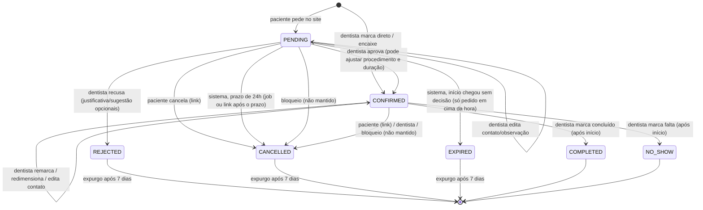

# Design: Agenda e Agendamento (disponibilidade, pedidos online, painel da dentista, e-mails)

Status: aprovado em conversa, aguardando revisão (revisado após respostas do usuário/cliente
e revisão de construção, 28/10)
Escopo: configuração da agenda (procedimentos, horário semanal, bloqueios, feriados e
desbloqueio de feriado), motor de cálculo de horários livres, agenda da dentista (marcação
direta, encaixes, remarcar, redimensionar, cancelar, editar contato/observação), pedido
online pelo paciente (pendente → aprovado/recusado, cancelamento automático, expiração,
cancelamento pelo paciente), retenção/expurgo de pedidos encerrados, e-mails
transacionais e lembrete. API NestJS + frontend Next.js 16, entregue em 4 fatias
verticais.
Fora de escopo: WhatsApp, múltiplos profissionais/cadeiras (o schema continua preparado,
ADR 005), conta/login de paciente, histórico/prontuário do paciente, pagamento/preço
(`Service.price` existe mas não é usado), lista de espera, recorrência de consultas,
horário extra aberto ao público (só encaixe pela dentista), relatórios, troca de telefone
de paciente, feriados de outras cidades/estados, política de retenção de consultas
realizadas.

**Legenda de origem das decisões** (para revisão):
- **(cliente)** — confirmado pela cliente (reunião de 28/10, ADR 019, ou respostas
  posteriores repassadas pelo usuário).
- **(usuário)** — decidido pelo Vitor no brainstorm/revisão.
- **(decisão de design)** — escolha do Claude ao escrever esta spec; **revisar**.

---

## 1. Contexto e porquê

Cliente real e pagante: a Dra. Eloísa, dentista em **Belo Horizonte (MG)** que atende
sozinha (uma profissional, sem recepcionista). Hoje a agenda é em papel. A reunião de 28/10
(ADR 019) fechou as regras que estavam em aberto desde 04/09
(`docs/reunioes/2026-09-04-pauta-requisitos.md`). O brainstorm e as respostas seguintes
resolveram o que a ADR 019 deixou aberto: grade de horários, pedido pendente bloquear
horário, quem escolhe o procedimento, bloqueios manuais, horário do lembrete, durações,
feriados locais, retenção de dados e recusa com justificativa.

O padrão de qualidade é de produção: o sistema vai receber pedidos de pacientes reais pela
internet, guarda dado pessoal com relação a saúde (LGPD) e um erro de agenda (dois
pacientes no mesmo horário, pedido esquecido) é um problema real no consultório.

A cliente quer ver progresso. Por isso o módulo é entregue em **4 fatias verticais**
(backend + tela), cada uma utilizável sozinha **(usuário)**:

1. Configuração da agenda.
2. Agenda da dentista (já substitui a agenda de papel, sem site público).
3. Pedido online.
4. E-mails e lembrete.

O Auth já está pronto: login da dentista, JWT em cookie httpOnly, `JwtAuthGuard` global
via `APP_GUARD` (nega por padrão), decorator `@Public()` (`apps/api/src/auth/decorators/
public.decorator.ts`), login com `@Throttle` de 5 req/min.

## 2. Objetivos, não-objetivos e anti-objetivos

**Objetivos**
- Paciente pede um horário pelo site sem conta, vendo só horários realmente livres.
- Dentista controla toda a agenda: aprova/recusa pedidos, marca direto, encaixa, move,
  muda duração, cancela, bloqueia períodos, desbloqueia feriado.
- Nunca existem dois agendamentos sobrepostos, nem sob concorrência (ADR 007).
- Nenhum pedido fica esquecido: prazos automáticos (cancelamento 24h, expiração) e e-mail
  para a dentista a cada pedido.
- Paciente com e-mail é avisado de toda mudança no seu agendamento e recebe lembrete.
- Pedidos recusados/cancelados/expirados não ficam guardados além de 1 semana (LGPD).

**Não-objetivos (v1)**
- Otimizar encaixe de horários (sugerir o melhor horário, compactar a agenda).
- Desfazer ações (reabrir cancelado/recusado). Para "desfazer", cria-se um novo
  agendamento.
- Edição do horário semanal pela tela é baixa prioridade (vem pré-carregado no seed).

**Anti-objetivos (o sistema não deve fazer)**
- Revelar a qualquer visitante quem está agendado, ou mesmo os intervalos ocupados com
  qualquer metadado. O público vê só horários de início disponíveis.
- Revelar se um telefone/e-mail já é paciente da clínica ou já tem pedidos.
- Cancelar algo só porque um link foi aberto (scanners de e-mail abrem links).
- Deixar o paciente sobrescrever dados cadastrais de outro paciente pelo formulário público.
- Ser fonte de prontuário clínico (o campo de observação não é prontuário).

## 3. Glossário

| Termo | Significado |
|---|---|
| **Procedimento** | Tipo de atendimento com duração (ex.: limpeza, 60 min). No código, model `Service` (já existe). Na tela, "procedimento". |
| **Grade** | Pontos de início possíveis a cada 30 min, ancorados no início de cada faixa de atendimento (08:00, 08:30, …, 13:30, 14:00, …). |
| **Horário livre** | Ponto da grade em que a duração inteira do atendimento cabe dentro de uma faixa de atendimento, sem cruzar almoço, fim do dia, bloqueio, feriado ou outro agendamento ocupante. |
| **Pedido pendente** | Agendamento `PENDING` criado pelo paciente no site. Ocupa o horário como uma consulta confirmada. |
| **Consulta confirmada** | Agendamento `CONFIRMED` (aprovado pela dentista ou marcado direto por ela). |
| **Agendamento ocupante** | Agendamento em status que ocupa o horário: `PENDING`, `CONFIRMED`, `COMPLETED`, `NO_SHOW`. |
| **Agendamento encerrado** | `REJECTED`, `CANCELLED` ou `EXPIRED`. Sujeito ao expurgo de 1 semana (RN-70). |
| **Marcação direta** | Agendamento criado pela dentista no painel (paciente ligou ou veio ao consultório). Nasce `CONFIRMED`. |
| **Encaixe** | Marcação direta fora da faixa de atendimento normal (antes das 08:00, no almoço, depois do fim do dia, fim de semana, feriado, dentro de bloqueio). Permitido desde que não sobreponha. |
| **Bloqueio** | Período (de minutos a vários dias) em que a dentista não atende pelo site: férias, curso, tarde de folga. Model novo `ScheduleBlock`. |
| **Feriado** | Dia em que "a cidade para" em BH: feriados nacionais, municipais de BH e segunda/terça de Carnaval (RN-08). Calculado automaticamente; bloqueia o dia inteiro para o público. |
| **Desbloqueio de feriado** | Decisão da dentista de atender pelo site num feriado específico (RN-46). Model novo `HolidayOverride`. |
| **Prazo de aprovação** | Para pedido feito com mais de 24h de antecedência: `startAt − 24h`. Passado esse prazo sem aprovação, o pedido é cancelado automaticamente. |
| **Expiração** | Pedido pendente cujo horário de início chegou sem decisão da dentista. |
| **Fuso da clínica** | `America/Sao_Paulo` (IANA). Toda regra de "dia", "hora", "manhã/tarde" é avaliada nele. |

## 4. Regras de negócio

Numeradas para que planos e testes possam referenciar (`RN-xx`). Números removidos ficam
marcados "(removida)"; regras novas recebem número novo, sem renumerar as existentes.

### 4.1 Horário semanal, grade e horários livres

- **RN-01 — Horário semanal (cliente).** No fuso da clínica, almoço fixo 11:00–13:30:

  | Dia | `dayOfWeek` | Manhã | Tarde | Linhas de `WorkingHours` (minutos) |
  |---|---|---|---|---|
  | Segunda | 1 | 08:00–11:00 | 13:30–17:00 | 480–660, 810–1020 |
  | Terça | 2 | 08:00–11:00 | 13:30–16:30 | 480–660, 810–990 |
  | Quarta | 3 | 08:00–11:00 | 13:30–17:00 | 480–660, 810–1020 |
  | Quinta | 4 | 08:00–11:00 | 13:30–16:30 | 480–660, 810–990 |
  | Sexta | 5 | 08:00–10:30 | — | 480–630 |
  | Sábado/domingo | 0, 6 | — | — | nenhuma |

  Vem pré-carregado pelo seed (ADR 006: almoço é a lacuna entre duas linhas).
- **RN-02 — Grade de 30 min (usuário).** Pontos de início oferecidos ao público estão a
  cada 30 min a partir do início de cada faixa. Ancorar na faixa (e não no relógio) é
  **(decisão de design)**; com o horário atual as duas coisas coincidem.
- **RN-03 — A duração inteira precisa caber (usuário).** Um ponto da grade só é oferecido
  se `[início, início + duração)` estiver inteiramente dentro de **uma** faixa de
  atendimento e não intersectar bloqueio, feriado (não desbloqueado) ou agendamento
  ocupante. Intervalos são semiabertos: uma consulta que termina 10:00 não conflita com
  outra que começa 10:00.
- **RN-04 — Sem procedimento = 30 min (usuário).** Pedido sem procedimento reserva 30 min.
- **RN-05 — Duração de procedimento: 30, 60 ou 90 min.** Mínimo 30 min e máximo 1h30
  **(cliente)**; só múltiplos de 30 **(decisão de design)**, para a grade ficar coerente
  ("procedimento longo ocupa várias unidades de 30 min"). Ajustes manuais da dentista
  (duração na aprovação, redimensionar, marcação direta sem procedimento) usam passos de
  15 min e **não** estão presos ao máximo de 90 **(decisão de design)** — teto de sanidade
  de 480 min. O motor funciona com qualquer minuto: agendamentos fora da grade só tornam
  indisponíveis os pontos que eles realmente intersectam.
- **RN-06 — (removida).** Antes tratava procedimentos acima de 210 min; com o máximo de
  90 min (RN-05) todo procedimento cabe em alguma faixa.
- **RN-07 — Sem horizonte e sem antecedência mínima (cliente).** Qualquer data futura;
  qualquer ponto da grade cujo início seja **estritamente posterior** a "agora" é
  oferecível (pontos que já começaram hoje não aparecem — **decisão de design**).
- **RN-08 — Feriados bloqueados: "a cidade parou, a clínica fecha" (cliente).** O dia
  inteiro (00:00–24:00 no fuso da clínica) fica sem horário livre para o público em:
  feriados nacionais **(cliente)**; feriados municipais de Belo Horizonte **(cliente)**;
  segunda e terça de Carnaval **(decisão de design**, a partir de "fecha quando a cidade
  para" — **confirmar com a cliente**). Lista e cálculo na seção 9.4.
- **RN-09 — O que não é feriado.** Quarta-feira de Cinzas (meio expediente em BH) não
  bloqueia **(decisão de design)**. Qualquer outro dia de folga é um bloqueio manual.

### 4.2 Pedido online (paciente, sem login)

- **RN-10 — Campos (cliente/usuário).** Obrigatórios: nome, telefone, e-mail. Opcionais:
  procedimento (de uma lista de procedimentos ativos) e observação em texto livre.
- **RN-11 — Validação (decisão de design).** Nome: 2–100 caracteres após `trim`, sem
  caracteres de controle. Telefone: número brasileiro, normalizado para E.164
  (`+55DDNNNNNNNNN`) antes de qualquer busca/gravação. E-mail: formato válido, máx. 254,
  sem CR/LF. Observação: máx. 500 caracteres, texto puro.
- **RN-12 — Nasce `PENDING` (cliente).** Todo pedido do site nasce pendente.
- **RN-13 — Pendente ocupa o horário (usuário).** Pedido pendente é ocupante: some dos
  horários livres para os outros e é barrado pela exclusion constraint (ADR 007).
- **RN-14 — Revalidação no servidor.** A API recalcula, na criação, se o horário pedido é
  livre (RN-03, RN-07, RN-08, bloqueios, desbloqueios) com a duração do procedimento
  **atual** no banco. Nunca confia no que o front diz estar livre nem em duração enviada
  pelo cliente.
- **RN-15 — Deduplicação por telefone (cliente), sem sobrescrita (decisão de design).**
  Telefone normalizado já existe → reaproveita o `Patient`, **sem alterar** nome/e-mail
  dele. Os dados digitados no pedido ficam no próprio agendamento (`contactName`,
  `contactEmail`). Telefone novo → cria `Patient` com nome/e-mail do formulário. O painel
  sinaliza quando o nome/e-mail do pedido diverge do cadastro, e a dentista decide se
  atualiza o cadastro. Motivo: sem isso, quem souber o telefone de outra pessoa troca o
  e-mail dela e passa a receber os lembretes dela.
- **RN-16 — Resposta não revela cadastro (decisão de design).** A resposta de sucesso é
  idêntica (forma e tempo aproximado) para telefone novo ou já existente. A única
  diferença observável possível é o limite da RN-18, que só aparece para quem já tem 2
  pedidos pendentes, e a mensagem dele não diz isso — sinal residual aceito.
- **RN-17 — Idempotência (ADR 011).** Obrigatória na criação pública **e** na marcação
  direta pela dentista **(decisão de design)**. O front gera uma `idempotencyKey` (UUID)
  por tentativa de envio do formulário. Repetir a mesma chave com o mesmo conteúdo devolve
  o mesmo agendamento (mesma resposta, sem criar outro, sem reenviar e-mail). Mesma chave
  com conteúdo diferente → 422 **(decisão de design)**. Na criação pública, a ordem de
  verificação é fixa: honeypot → busca pela `idempotencyKey` → captcha → transação
  **(decisão de design)**. Motivo: o token do Turnstile é de uso único; se o captcha viesse
  antes, um retry legítimo com a mesma chave falharia no captcha em vez de receber o
  pedido já criado. Buscar pela chave antes do captcha não abre brecha, porque só devolve o
  que aquela chave já criou.
- **RN-18 — Limite de pedidos ativos por telefone (decisão de design).** No máximo 2
  pedidos `PENDING` futuros por telefone normalizado. No 3º, a API responde 422 com código
  genérico `BOOKING_NOT_ALLOWED` e a mensagem "Não foi possível concluir seu pedido pelo
  site. Entre em contato com a clínica pelo telefone …" — sem mencionar pedidos
  existentes, o telefone ou o motivo. (Defesa parcial — telefone não é verificado; ver
  seção 10.)
- **RN-19 — Conflito na criação.** Se outro pedido ocupou o horário entre a consulta e o
  envio, a API responde 409 e a tela recarrega os horários livres ("esse horário acabou de
  ser ocupado"). O código é `SLOT_UNAVAILABLE`, o mesmo para qualquer motivo de o horário
  não ser oferecível (ocupado, bloqueio, feriado, fora da grade, passado, não cabe), para
  não revelar o que a disponibilidade pública esconde (10.3) **(decisão de design)**.

### 4.3 Decisão da dentista sobre pedidos

- **RN-20 — Aprovar (cliente).** `PENDING → CONFIRMED`. Na aprovação ela pode trocar o
  procedimento (inclusive definir um quando o paciente não escolheu) e a duração (passos
  de 15 min, sem o teto de 90 — RN-05); o início não muda na aprovação **(decisão de
  design)** — para mudar o horário, aprova e depois remarca (RN-31), ou recusa. A nova
  duração é checada contra sobreposição; se conflitar, 409 com o agendamento conflitante e
  nada muda.
- **RN-21 — Recusar (cliente), com justificativa e sugestão opcionais (usuário).**
  `PENDING → REJECTED`; libera o horário na hora. A dentista pode escrever uma
  justificativa (texto livre, máx. 500) e/ou sugerir outro horário (data e hora futuras).
  Os dois são opcionais e aparecem no e-mail de recusa. A sugestão é só informativa: **não
  reserva** o horário, que continua livre para qualquer um, e não precisa estar livre nem
  na grade **(decisão de design)**.
- **RN-22 — Pendente não é movido sem decidir (decisão de design).** A dentista não move
  nem redimensiona um pedido pendente fora do fluxo de aprovação. Mantém a máquina de
  estados e a regra das 24h simples. Editar contato e observação é permitido (RN-38).
- **RN-23 — Cancelamento automático das 24h (usuário).** Se o pedido foi criado
  **estritamente antes** de `startAt − 24h` e continua `PENDING` quando `agora ≥ startAt −
  24h`, vira `CANCELLED` (`cancelledBy = SYSTEM`, `cancelReason = APPROVAL_TIMEOUT`) e o
  horário é liberado.
- **RN-24 — Pedido em cima da hora nunca é cancelado automaticamente (usuário).** Pedido
  criado em `createdAt ≥ startAt − 24h` (inclui exatamente 24h) fica pendente até a
  dentista decidir ou até expirar (RN-25).
- **RN-25 — Expiração (decisão de design, sem objeção do usuário).** Pedido em cima da hora
  (RN-24) ainda `PENDING` com `agora ≥ startAt` vira `EXPIRED`. Sem e-mail ao paciente
  **(decisão de design)**. O desfecho segue a regra que venceu primeiro, não o momento em
  que o job rodou **(decisão de design)**: pedido feito com mais de 24h de antecedência
  sempre termina `CANCELLED`/`APPROVAL_TIMEOUT` (RN-23), mesmo que só seja processado
  depois do início (servidor fora do ar); só o pedido em cima da hora termina `EXPIRED`.
  É o mesmo critério da RN-54.
- **RN-26 — O prazo é determinístico (decisão de design).** A aprovação só é aceita se, no
  momento do `UPDATE`, o pedido ainda está `PENDING` **e** não passou do seu prazo (RN-23)
  nem do início (RN-25). Não depende de o job já ter rodado: aprovar depois do prazo dá
  409 "pedido expirou", mesmo que o job ainda não o tenha cancelado. O mesmo prazo vale
  para as outras ações da dentista sobre um pedido `PENDING` **(usuário, 28/10/2026)**:
  recusar (T4) e editar contato (T13) depois do prazo dão 409 `APPROVAL_EXPIRED`; o
  bloqueio (T7) não o lista nem o cancela (RN-43). Assim o pedido vencido sempre termina
  `CANCELLED`/`APPROVAL_TIMEOUT`, com o e-mail de prazo esgotado, e não com o de recusa
  ou de bloqueio.
- **RN-27 — Janela curta é aceita (usuário).** Pedido feito com 24h05min de antecedência
  dá 5 min para aprovar antes do cancelamento automático. Aceito como está.

### 4.4 Controle da dentista sobre a agenda

- **RN-30 — Marcação direta nasce `CONFIRMED` (decisão de design, interpretação de "a
  dentista marca direto").** Obrigatórios: nome e telefone (mesma normalização/
  deduplicação). E-mail opcional. Procedimento opcional (sem procedimento: duração
  informada por ela, passos de 15 min, padrão 30 min). Exige `idempotencyKey` (RN-17).
- **RN-31 — Remarcar e redimensionar (usuário).** A dentista pode mudar início e/ou
  duração de qualquer agendamento `CONFIRMED` futuro. Continua `CONFIRMED`.
- **RN-32 — Cancelar (cliente).** A dentista cancela qualquer `CONFIRMED` **futuro**
  (`agora < startAt`; `cancelledBy = DENTIST`, `cancelReason = DENTIST`). Para `PENDING`,
  a ação é recusar (RN-21).
- **RN-33 — Nunca sobrepor (ADR 007, usuário).** Toda criação/remarcação/
  redimensionamento que sobreponha um agendamento ocupante é recusada com 409 e a lista dos
  agendamentos conflitantes (horário e nome — painel autenticado). A dentista resolve
  ajustando um dos dois. Isso vale também contra pedidos pendentes: para usar o horário de
  um pendente, ela recusa o pendente antes.
- **RN-34 — Encaixe (cliente).** Marcação direta e remarcação pela dentista ignoram faixa
  de atendimento, feriado e bloqueio; só a não sobreposição é obrigatória. A tela avisa
  ("fora do horário de atendimento", "dia de feriado", "dentro do bloqueio X") mas permite.
- **RN-35 — Sem passado (usuário).** A dentista não cria nem move agendamento para um
  início no passado, e não remarca um agendamento que já começou. Sem tolerância.
- **RN-36 — Concluído / faltou (decisão de design, baixa prioridade).** Depois do início,
  a dentista pode marcar um `CONFIRMED` como `COMPLETED` ou `NO_SHOW`. Não existe transição
  automática; `CONFIRMED` no passado é lido como "aconteceu".
- **RN-37 — Avisar o paciente é o padrão (decisão de design).** Em marcação direta,
  remarcação e cancelamento pela dentista, a tela tem "avisar paciente por e-mail" marcado
  por padrão (só aparece se houver e-mail). Ela pode desmarcar (ex.: já combinou por
  telefone).
- **RN-38 — Editar contato e observação (usuário).** Em agendamento `PENDING` ou
  `CONFIRMED` futuro, a dentista edita `contactName`, `contactEmail` e `notes`. O telefone
  não é editável pelo agendamento: ele identifica o `Patient` **(decisão de design)**.
  Editar não muda o `Patient` (isso é a ação de atualizar cadastro da RN-15). Efeitos no
  e-mail **(decisão de design)**:
  - incluir e-mail onde não havia → gera `cancellationToken`; nenhum e-mail retroativo
    (nem "confirmação"); o próximo e-mail relevante (remarcação, lembrete, cancelamento)
    já leva o link;
  - trocar o e-mail → gera token novo (o link enviado ao endereço antigo para de
    funcionar);
  - remover o e-mail → token vira nulo; nenhum e-mail a partir daí.

### 4.5 Procedimentos, bloqueios, feriados e horário semanal

- **RN-40 — Procedimentos (usuário).** A dentista cria (nome + duração 30/60/90), edita e
  desativa. Não existe exclusão: desativar tira da lista pública e da lista do painel para
  novos agendamentos, mas agendamentos existentes continuam mostrando o nome. Nome único
  entre procedimentos ativos, sem diferenciar maiúsculas **(decisão de design)**.
- **RN-41 — Mudar duração não mexe no que já existe.** `endAt` é denormalizado
  (schema atual); a nova duração vale só para pedidos/marcações novos.
- **RN-42 — Bloqueio (usuário).** A dentista cria bloqueio de dia(s) inteiro(s) ou de
  período (início e fim com data e hora), com motivo opcional (só ela vê). Bloqueio só
  restringe o público (RN-03); encaixe continua possível (RN-34).
- **RN-43 — Bloqueio sobre agendamentos existentes (usuário).** Ao criar um bloqueio que
  intersecta agendamentos ocupantes **futuros** (`PENDING`/`CONFIRMED` com `startAt >
  agora`, exceto `PENDING` com o prazo da RN-26 vencido), o sistema mostra uma mensagem listando-os e pergunta se ela quer **manter**
  algum. Padrão: cancelar todos (caminho simples); ela pode marcar os que quer manter.
  - Confirmando, o bloqueio é criado; os não mantidos viram `CANCELLED`
    (`cancelledBy = DENTIST`, `cancelReason = BLOCK`) e cada paciente com e-mail é avisado;
    os mantidos ficam dentro do bloqueio, intactos (o bloqueio só restringe o público).
  - A confirmação envia o conjunto de afetados que ela viu (`affectedIds`) e os que quer
    manter (`keepIds ⊆ affectedIds`). A API recalcula o conjunto afetado; se for diferente
    do enviado (chegou ou saiu um agendamento), responde 409 com a lista atualizada e nada
    muda.
  - Agendamento em andamento (`startAt ≤ agora < endAt`) não é afetado: não aparece na
    lista e não é cancelado **(decisão de design)**. Agendamentos já passados também não.
- **RN-44 — Apagar bloqueio não ressuscita nada (decisão de design).** Agendamentos
  cancelados pelo bloqueio continuam cancelados.
- **RN-45 — Horário semanal editável (decisão de design, baixa prioridade).** Se for
  editado, agendamentos futuros que ficarem fora do novo horário **não** são cancelados;
  o painel os destaca como "fora do horário". Validação: faixas do mesmo dia não se
  sobrepõem, `0 ≤ início < fim ≤ 1440`.
- **RN-46 — Desbloquear um feriado (usuário).** A dentista pode marcar uma data de
  feriado específica como "atender neste dia". Nesse dia o público vê o horário semanal
  normal daquele dia da semana (bloqueios continuam valendo). Só datas que o calendário de
  feriados (RN-08) aponta como feriado podem ser desbloqueadas; outra data → 422. Desfazer
  o desbloqueio volta a fechar o dia; agendamentos já marcados nele **não** são cancelados,
  o painel os destaca como "em feriado" **(decisão de design)**. Uso esperado: raríssimo.

### 4.6 Cancelamento pelo paciente

- **RN-50 — Até a hora da consulta (cliente).** Com o link (ADR 009), o paciente cancela
  um agendamento `PENDING` ou `CONFIRMED` enquanto `agora < startAt`. Depois disso, o link
  só mostra o estado. A exceção é o pendente com prazo vencido: nele o `confirm` só
  materializa o cancelamento pelo sistema (RN-54), não um cancelamento pelo paciente.
- **RN-51 — Abrir o link não cancela (decisão de design).** A página mostra data, hora e
  procedimento e um botão "cancelar"; só o clique (POST) cancela.
- **RN-52 — Sem e-mail, sem link.** Paciente sem e-mail (marcação direta sem e-mail) não
  recebe link; cancela ligando para a clínica.
- **RN-53 — Link exibido na tela (fatia 3) e por e-mail (fatia 4).** O link aparece na tela
  de sucesso do pedido desde a fatia 3 e continua aparecendo depois que os e-mails
  existirem **(decisão de design)**.
- **RN-54 — Pendente com prazo vencido (decisão de design).** Link de um `PENDING` cujo
  prazo de 24h (RN-23) já passou, com o job ainda sem rodar:
  - **Abrir** (`lookup`) não grava nada: a página já mostra o estado efetivo, "este pedido
    foi cancelado por não ter sido aprovado a tempo", sem botão de cancelar. Assim o
    `lookup` continua sem efeito colateral (RN-51) **(decisão de design)**.
  - **Usar** (`confirm`, por exemplo numa página aberta antes do prazo ou num POST direto)
    registra o cancelamento pelo sistema (`cancelledBy = SYSTEM`,
    `cancelReason = APPROVAL_TIMEOUT`), com os mesmos e-mails do cancelamento automático,
    não os do cancelamento pelo paciente. Isso vale mesmo depois do início (RN-25).

  O resultado não depende de quem chegou primeiro, o job ou o paciente.

### 4.7 Notificações (e-mail, v1)

- **RN-60 — Para o paciente** (só se o agendamento tem `contactEmail`), um e-mail em cada
  evento:

  | Evento | E-mail | Origem |
  |---|---|---|
  | Pedido recebido (pendente) | "Recebemos seu pedido", com o link de cancelamento | decisão de design |
  | Aprovado | Confirmação com data/hora, endereço, link de cancelamento | cliente |
  | Recusado | Aviso, com justificativa e/ou horário sugerido se a dentista escreveu (RN-21), e telefone da clínica | usuário |
  | Cancelado pelas 24h (job ou RN-54) | Aviso, com telefone da clínica | usuário |
  | Cancelado por bloqueio | Aviso, com telefone da clínica | usuário |
  | Cancelado pela dentista | Aviso (se "avisar paciente" marcado) | usuário |
  | Remarcado pela dentista | Novo horário + link (se "avisar paciente" marcado) | usuário |
  | Marcação direta | Confirmação + link (se "avisar paciente" marcado) | decisão de design |
  | Cancelado pelo próprio paciente | Confirmação do cancelamento (sinal de segurança se outra pessoa usou o link) | decisão de design |
  | Contato editado (RN-38) | nenhum | decisão de design |
  | Expirado | nenhum | decisão de design |

- **RN-61 — Para a dentista (usuário).** A cada pedido novo: nome do paciente, data, hora,
  procedimento (ou "sem procedimento") e link que abre o pedido no painel (o link exige
  login; não carrega token). Também a cada cancelamento feito pelo paciente **(decisão de
  design)** — o horário liberou e ela pode querer ocupá-lo.
- **RN-62 — Lembrete às 07:00 (usuário).** Só `CONFIRMED`, só com e-mail. Consulta à
  tarde (início local ≥ 12:00 — limite **decisão de design**) recebe às 07:00 do mesmo
  dia; consulta de manhã (início < 12:00) recebe às 07:00 do dia anterior (inclusive
  domingo, para consulta de segunda de manhã).
- **RN-63 — Lembrete com recuperação e sem repetição (decisão de design).** "Momento do
  lembrete" (`dueAt`) = 07:00 local do dia certo para o `startAt` atual. O lembrete é
  enviado se, ao mesmo tempo:
  1. `dueAt ≤ agora < startAt`;
  2. ainda não existe `Notification` de lembrete para esse agendamento e esse `startAt`
     (`dedupeKey`);
  3. não existe `Notification` de agendamento — confirmação (aprovação ou marcação direta)
     ou remarcação — desse agendamento criada em `≥ dueAt` com status `PENDING` ou `SENT`.
     Ou seja: se o paciente recebeu (ou está para receber) um e-mail com o horário depois do
     momento do lembrete, o lembrete não sai.

  Consequências: servidor fora às 07:00 → envia quando voltar; confirmado ou remarcado com
  aviso depois do momento do lembrete → sem lembrete; remarcado sem aviso → lembrete
  normal; e-mail de confirmação que falhou de vez (`FAILED`) não impede o lembrete. Tudo
  sai da tabela `Notification`, sem coluna nova em `Appointment`.
- **RN-64 — Conteúdo mínimo (decisão de design).** Assunto fixo, sem dado do paciente
  (ex.: "Sua consulta foi confirmada"). Corpo: primeiro nome, data, hora, procedimento,
  endereço/telefone da clínica, link. Texto livre escrito **pelo paciente** (observação)
  nunca vai em e-mail. Texto escrito **pela dentista** (justificativa de recusa) pode ir,
  escapado. Nenhum dado do paciente vai em cabeçalho de e-mail.

### 4.8 Retenção de dados (LGPD)

- **RN-70 — Expurgo de pedidos encerrados após 1 semana (cliente).** Agendamentos
  `REJECTED`, `CANCELLED` e `EXPIRED` são apagados 7 dias depois de encerrados
  (`closedAt + 7 dias`; contar a partir do encerramento, não da data da consulta, é
  **decisão de design**). Um job diário apaga **(decisão de design)**:
  - o agendamento;
  - seus `AppointmentEvent` e `Notification`;
  - o `Patient`, se ele ficar sem nenhum agendamento.
- **RN-71 — Fora do expurgo (cliente/usuário).** `PENDING`, `CONFIRMED`, `COMPLETED` e
  `NO_SHOW` não são apagados por esta regra; a retenção deles é questão em aberto.
- **RN-72 — Controladora dos dados (cliente).** A clínica, pelo CNPJ.

## 5. Máquina de estados do agendamento

Enum resultante: `PENDING | CONFIRMED | REJECTED | CANCELLED | EXPIRED | COMPLETED |
NO_SHOW` (`REJECTED` e `EXPIRED` são novos — seção 6.2). Estados terminais: todos menos
`PENDING` e `CONFIRMED`. Nenhum terminal volta a ativo. Encerrados (`REJECTED`,
`CANCELLED`, `EXPIRED`) são apagados após 1 semana (RN-70).



| # | De → Para | Quem dispara | Condição (guarda) | Efeitos | Evento (ADR 003) | E-mail |
|---|---|---|---|---|---|---|
| T1 | ∅ → `PENDING` | Paciente (público) | RN-10..19 | cria/reutiliza `Patient`; grava contato; gera token | `appointment.requested` | paciente: recebido; dentista: novo pedido |
| T2 | ∅ → `CONFIRMED` | Dentista | RN-30, RN-33, RN-35 | `confirmedAt = agora`; token só se houver e-mail | `appointment.confirmed` | paciente: confirmação (RN-37) |
| T3 | `PENDING` → `CONFIRMED` | Dentista | RN-26; nova duração sem conflito | `confirmedAt`; pode mudar `serviceId`/`endAt` | `appointment.confirmed` | paciente: confirmação |
| T4 | `PENDING` → `REJECTED` | Dentista | status ainda `PENDING` e prazo não vencido (RN-26) | libera horário; grava `rejectionMessage`/`suggestedStartAt`; `closedAt` | `appointment.rejected` | paciente: recusa (com justificativa/sugestão) |
| T5 | `PENDING` → `CANCELLED` | Paciente | token válido, `agora < startAt`, prazo de 24h **não** vencido | `cancelledBy=PATIENT`, `cancelReason=PATIENT`; `closedAt` | `appointment.cancelled` | paciente: confirmação; dentista: aviso |
| T5b | `PENDING` → `CANCELLED` | Paciente (`confirm` do link) com prazo vencido | token válido, pedido não em cima da hora, `agora ≥ startAt − 24h` (RN-54; vale mesmo depois do início) | igual a T6 | `appointment.cancelled` | igual a T6 |
| T6 | `PENDING` → `CANCELLED` | Job | RN-23: pedido não em cima da hora e `agora ≥ startAt − 24h` (vale mesmo depois do início — RN-25) | `cancelledBy=SYSTEM`, `cancelReason=APPROVAL_TIMEOUT`; `closedAt` | `appointment.cancelled` | paciente: aviso |
| T7 | `PENDING`/`CONFIRMED` → `CANCELLED` | Dentista (bloqueio) | RN-43 confirmado, não está em `keepIds`, `startAt > agora`; se `PENDING`, prazo não vencido (RN-26) | `cancelledBy=DENTIST`, `cancelReason=BLOCK`; `closedAt` | `appointment.cancelled` | paciente: aviso |
| T8 | `PENDING` → `EXPIRED` | Job | pedido em cima da hora (RN-24) e `agora ≥ startAt` (RN-25) | `closedAt` | `appointment.expired` | nenhum |
| T9 | `CONFIRMED` → `CONFIRMED` | Dentista | RN-31, RN-33, RN-35 | muda `startAt`/`endAt`/`serviceId` | `appointment.rescheduled` | paciente: novo horário (RN-37) |
| T10 | `CONFIRMED` → `CANCELLED` | Paciente | token válido, `agora < startAt` | `cancelledBy=PATIENT`, `cancelReason=PATIENT`; `closedAt` | `appointment.cancelled` | paciente: confirmação; dentista: aviso |
| T11 | `CONFIRMED` → `CANCELLED` | Dentista | `agora < startAt` | `cancelledBy=DENTIST`, `cancelReason=DENTIST`; `closedAt` | `appointment.cancelled` | paciente: aviso (RN-37) |
| T12 | `CONFIRMED` → `COMPLETED`/`NO_SHOW` | Dentista | `agora ≥ startAt` | — | — | nenhum |
| T13 | `PENDING`/`CONFIRMED` → mesmo status | Dentista | `agora < startAt` (RN-38); se `PENDING`, prazo não vencido (RN-26) | muda `contactName`/`contactEmail`/`notes`; gera/rotaciona/anula token conforme RN-38 | `appointment.contact_updated` | nenhum |
| T14 | encerrado → (apagado) | Job diário | `closedAt + 7 dias ≤ agora` (RN-70) | apaga agendamento, eventos, notificações e `Patient` órfão | — | nenhum |

**Toda transição é um `UPDATE` condicional** (`WHERE id = $1 AND status = <esperado> AND
<guardas de tempo>`) e checa as linhas afetadas; 0 linhas → 409 com o estado atual. É isso
que resolve as corridas job × dentista × paciente (seção 9.2). Cada transição (T1–T13)
grava **uma** linha em `AppointmentEvent` (seção 6.7) na mesma transação; T9 grava um
único evento `rescheduled` com início e fim de antes e depois, cobrindo remarcar e
redimensionar.

## 6. Modelo de dados — mudanças sobre o schema atual

Base: `apps/api/prisma/schema.prisma` e as 3 migrations existentes (`init`,
`timestamptz`, `add_refresh_token`). Todas as mudanças abaixo são aditivas ou sobre
tabelas ainda vazias em produção (não há produção ainda), então não há migração de dados.

### 6.1 `Patient` — ajusta ADR 008 e ADR 019

| Mudança | Detalhe | Porquê |
|---|---|---|
| `email String?` | Nullable | Obrigatório só no formulário público (RN-10); marcação direta aceita sem e-mail (RN-30). **Refina a ADR 019**, que dizia "e-mail obrigatório" sem distinguir os dois fluxos. |
| `phone` passa a guardar E.164 | Normalização na aplicação; `@unique` continua; imutável na v1 | Sem normalização, `(11) 99999-0000` e `11999990000` viram dois pacientes. |
| Pode ser apagado | FK de `Appointment.patientId` continua `RESTRICT`; o expurgo apaga o paciente só depois de ele ficar sem agendamentos (RN-70) | LGPD. |

### 6.2 `AppointmentStatus` e `CancelledBy` — ajusta ADR 010

- `AppointmentStatus` ganha `REJECTED` e `EXPIRED` **(decisão de design)**. Alternativa
  rejeitada: tudo virar `CANCELLED` + motivo — mistura "a dentista disse não" com "o
  paciente desistiu" em toda query/tela.
- `CancelledBy` ganha `SYSTEM` (cancelamento das 24h).
- Novo enum `CancelReason { PATIENT, DENTIST, BLOCK, APPROVAL_TIMEOUT }` e campo
  `Appointment.cancelReason CancelReason?`.
- **Atenção na migration:** no Postgres, um valor novo de enum adicionado com `ALTER TYPE
  ... ADD VALUE` não pode ser usado na mesma transação. A recriação da constraint (6.3)
  que cita `'REJECTED'`/`'EXPIRED'` vai numa **migration separada**, depois da que adiciona
  os valores.

### 6.3 Exclusion constraint — ajusta ADR 007

Hoje: `WHERE (status <> 'CANCELLED')`. Passa a ser:

```sql
ALTER TABLE "Appointment" DROP CONSTRAINT no_overlapping_appointments;
ALTER TABLE "Appointment"
  ADD CONSTRAINT no_overlapping_appointments
  EXCLUDE USING gist (
    "professionalId" WITH =,
    tstzrange("startAt", "endAt") WITH &&
  )
  WHERE (status NOT IN ('CANCELLED', 'REJECTED', 'EXPIRED'));
```

Lista negativa de propósito **(decisão de design)**: um status novo adicionado no futuro
ocupa o horário por padrão (falha para o lado seguro, que é não sobrepor). A ADR 007
continua valendo na essência; muda o predicado. Adicionar também
`CHECK ("startAt" < "endAt")` (hoje não existe).

### 6.4 `Appointment` — campos novos/alterados

| Campo | Tipo | Porquê |
|---|---|---|
| `serviceId` | `String` → `String?` | Pedido sem procedimento (RN-04). FK continua `RESTRICT`, escrito explicitamente (`onDelete: Restrict`): para relação opcional o padrão do Prisma é `SetNull` **(decisão de design)**. |
| `source` | enum `AppointmentSource { PUBLIC, DENTIST }` | Distingue pedido do site de marcação direta (regras, telas, auditoria). **(decisão de design)** |
| `contactName` | `String` | Nome como digitado neste agendamento (RN-15); editável pela dentista (RN-38). |
| `contactEmail` | `String?` | Destino de todos os e-mails deste agendamento (RN-15, RN-60); editável (RN-38). Em marcação direta, pré-preenchido com `Patient.email`. |
| `confirmedAt` | `DateTime? @db.Timestamptz(3)` | Auditoria e painel. (A regra do lembrete não usa mais este campo — RN-63.) |
| `cancelReason` | `CancelReason?` | 6.2. |
| `rejectionMessage` | `String?` (máx. 500) | Justificativa da recusa (RN-21). Texto da dentista. |
| `suggestedStartAt` | `DateTime? @db.Timestamptz(3)` | Horário sugerido na recusa (RN-21). Informativo; não ocupa nada. |
| `closedAt` | `DateTime? @db.Timestamptz(3)` | Momento em que virou `REJECTED`/`CANCELLED`/`EXPIRED`; base do expurgo (RN-70). **(decisão de design)** — `cancelledAt` sozinho não cobre recusa nem expiração. |
| `cancellationToken` | `String? @unique`, sem `@default(uuid())` | Gerado na aplicação com `crypto.randomBytes(32)` em base64url (256 bits). Nullable: sem e-mail, sem link (RN-52). Rotacionado quando o e-mail muda (RN-38). Ver 10.4. |
| `notes` | continua `String?` | Campo de descrição compartilhado (reunião de 04/09): o paciente preenche no pedido, a dentista pode editar (RN-38). Máx. 500. |

Índices: manter `(professionalId, startAt)` e `(patientId)`. Adicionar `(status,
startAt)` para os jobs de pendentes e lembrete, e `(status, closedAt)` para o expurgo.

### 6.5 `ScheduleBlock` (novo) substitui `ScheduleException` — ajusta ADR 006

```prisma
model ScheduleBlock {
  id             String       @id @default(uuid())
  professional   Professional @relation(fields: [professionalId], references: [id], onDelete: Cascade)
  professionalId String
  startAt        DateTime     @db.Timestamptz(3)
  endAt          DateTime     @db.Timestamptz(3)
  reason         String?      // só a dentista vê
  createdAt      DateTime     @default(now()) @db.Timestamptz(3)

  @@index([professionalId, startAt])
}
```

Mais `CHECK ("startAt" < "endAt")` na migration. Bloqueio de dia inteiro = `[00:00 local
do primeiro dia, 00:00 local do dia seguinte ao último)` convertido para UTC.

**Por que não `ScheduleException` (decisão de design):** ela tem `@@unique([professionalId,
date])` e uma única faixa por dia. Não representa férias de duas semanas (14 linhas), nem
"bloquear 09:00–10:00" no meio da manhã (sobram duas faixas, não cabe em um
`CUSTOM_HOURS`). Feriados não precisam dela (calculados, seção 9.4). Proposta: **remover
`ScheduleException` e o enum `ExceptionType`** (tabela vazia) para não ter duas fontes de
verdade. Se um dia surgir "abrir horário extra ao público num sábado", isso vira um model
próprio de abertura. A ideia central da ADR 006 (regras recorrentes + exceções, sem slots
pré-gerados) continua; muda o formato da exceção.

### 6.6 `HolidayOverride` (novo) — desbloqueio de feriado (decisão de design)

```prisma
model HolidayOverride {
  id             String       @id @default(uuid())
  professional   Professional @relation(fields: [professionalId], references: [id], onDelete: Cascade)
  professionalId String
  date           DateTime     @db.Date   // data local do feriado desbloqueado
  createdAt      DateTime     @default(now()) @db.Timestamptz(3)

  @@unique([professionalId, date])
}
```

Tabela própria em vez de um "tipo abrir" em `ScheduleBlock`: bloqueio subtrai horário,
desbloqueio só anula o feriado calculado daquela data. Misturar os dois num model faria
toda consulta de bloqueio filtrar por tipo, e um "bloqueio que abre" é confuso de ler.
Desfazer o desbloqueio = apagar a linha.

### 6.7 `AppointmentEvent` (novo) — trilha de auditoria (decisão de design)

```prisma
model AppointmentEvent {
  id            String             @id @default(uuid())
  appointment   Appointment        @relation(fields: [appointmentId], references: [id], onDelete: Cascade)
  appointmentId String
  type          String             // requested, confirmed, rejected, cancelled, expired, rescheduled, contact_updated, completed, no_show
  actor         CancelledBy        // PATIENT | DENTIST | SYSTEM (reaproveita o enum; renomear para Actor é aceitável)
  fromStatus    AppointmentStatus?
  toStatus      AppointmentStatus
  fromStartAt   DateTime?          @db.Timestamptz(3)
  fromEndAt     DateTime?          @db.Timestamptz(3)
  toStartAt     DateTime?          @db.Timestamptz(3)
  toEndAt       DateTime?          @db.Timestamptz(3)
  createdAt     DateTime           @default(now()) @db.Timestamptz(3)

  @@index([appointmentId])
}
```

Justificativa: o sistema tem ações automáticas (cancelamento 24h, expiração) e um
paciente vai, cedo ou tarde, dizer "eu marquei e sumiu". Com a trilha, a dentista (e o
dev) responde com fato. Sem dado pessoal na tabela; só tempos e estados (o evento
`contact_updated` não guarda os valores antigos/novos). Não existe tipo `resized`:
remarcar e redimensionar são o mesmo evento `rescheduled`, com início e fim de antes e
depois. Os eventos são apagados junto com o agendamento no expurgo (RN-70).

### 6.8 `Notification` (novo) — fila de e-mail com idempotência (decisão de design, fatia 4)

```prisma
model Notification {
  id            String       @id @default(uuid())
  appointment   Appointment? @relation(fields: [appointmentId], references: [id], onDelete: Cascade)
  appointmentId String?
  kind          String   // request_received, confirmed, direct_booking, rejected, cancelled_*, rescheduled, reminder, patient_cancelled_confirmation, dentist_new_request, dentist_patient_cancelled
  dedupeKey     String   @unique   // ex.: "reminder:{appointmentId}:{startAt ISO}"
  status        String   // PENDING | SENT | FAILED
  attempts      Int      @default(0)
  nextAttemptAt DateTime @db.Timestamptz(3)
  sentAt        DateTime? @db.Timestamptz(3)
  lastError     String?  // sem dado pessoal
  createdAt     DateTime @default(now()) @db.Timestamptz(3)

  @@index([status, nextAttemptAt])
  @@index([appointmentId, kind, createdAt])
}
```

O módulo de notificações escuta os eventos (ADR 003), grava a linha e um worker envia com
retentativa (backoff, máx. 5 tentativas). `dedupeKey` único garante que job duplicado ou
evento repetido não envia dois e-mails. O destinatário e o link são lidos do agendamento
no momento do envio (não ficam copiados aqui). A regra do lembrete (RN-63) consulta esta
tabela pelo índice `(appointmentId, kind, createdAt)`. Strings em vez de enums para
`kind`/`status` é aceitável nesta tabela; quem implementa pode usar enums.

### 6.9 Seed

O seed atual só cria o `User`. Passa a: criar o `Professional` ligado ao `User` (upsert);
criar as 9 linhas de `WorkingHours` da RN-01 **só se a profissional não tiver nenhuma**
(não sobrescreve edição feita em produção — **decisão de design**); criar os
procedimentos iniciais quando a cliente enviar a lista.

### 6.10 ADRs a registrar quando esta spec for aprovada

Uma ADR nova (020) cobrindo:
- `ScheduleBlock` no lugar de `ScheduleException`, feriados calculados (nacionais + BH +
  Carnaval) e `HolidayOverride` (ajusta 006);
- predicado da constraint (ajusta 007);
- `Patient.email` nullable e telefone E.164 sem sobrescrita (ajusta 008/019);
- token gerado na aplicação, nullable, rotacionado na troca de e-mail, cancelamento só por
  POST, válido até `startAt` (ajusta 009);
- `REJECTED`/`EXPIRED`/`SYSTEM` (ajusta 010);
- outbox de e-mail, trilha de auditoria e expurgo de 7 dias (LGPD).

Mais uma ADR por dependência nova (seção 11), uma para o provedor de e-mail (9.6) e uma
atualização da ADR 018 com a topologia de subdomínios e o domínio do cookie (9.9).

## 7. Superfície da API (indicativa)

Rotas exatas ficam a critério de quem implementa; o que é fixo é **quais são públicas**.

**Públicas (`@Public()`)** — a lista é fechada; adicionar uma rota pública exige revisão:

| Rota | Função |
|---|---|
| `GET /public/procedures` | Procedimentos ativos: id, nome, duração. |
| `GET /public/availability?from&to&serviceId?` | Inícios livres (ISO UTC) por dia. Intervalo máx. 31 dias por chamada **(decisão de design)**. Só inícios; nada sobre ocupação. |
| `POST /public/appointments` | Cria pedido (T1). Exige `idempotencyKey` e token de captcha. |
| `POST /public/cancellation/lookup` | `{ token }` → data, hora, procedimento, status **efetivo** (RN-54), se pode cancelar. Sem efeito colateral. |
| `POST /public/cancellation/confirm` | `{ token }` → cancela (T5/T5b/T10). |

**Autenticadas (dentista):**
- procedimentos (CRUD);
- horário semanal: leitura (edição, baixa prioridade);
- bloqueios: prévia de afetados, criar com `affectedIds` + `keepIds`, listar, apagar;
- desbloqueio de feriado: criar e apagar;
- `GET /calendar?from&to` (agendamentos + bloqueios + feriados + desbloqueios do período);
- agendamentos:
  - marcação direta (com `idempotencyKey`);
  - aprovar (com ajuste);
  - recusar (com `rejectionMessage`/`suggestedStartAt` opcionais);
  - remarcar/redimensionar;
  - editar contato/observação (T13);
  - cancelar;
  - marcar concluído/falta;
- lista de pendentes com prazo e recusa em lote;
- atualizar cadastro de paciente a partir da divergência (RN-15).

O `professionalId` é sempre derivado do usuário logado (`User → Professional`), nunca
aceito do corpo da requisição.

## 8. Fatias de entrega e critérios de aceite

Datas de exemplo: segunda 09/11/2026, terça 10/11, sexta 13/11; horários no fuso da
clínica. Cada critério deve virar pelo menos um teste (unitário no motor/serviços, e2e
nos fluxos). Critérios removidos ficam marcados "(removido)"; novos recebem número novo.

### Fatia 1 — Configuração da agenda

**O que a cliente usa no fim:** entra no painel, cadastra/edita/desativa os
procedimentos, vê o horário semanal pré-carregado, cria e apaga bloqueios, vê os feriados
marcados no calendário e pode desbloquear um feriado. Por baixo, o motor de horários
livres pronto e testado.

**Escopo:**
- migrations da seção 6 (todas as de schema, para não migrar de novo a cada fatia);
- seed (6.9) e `Professional` ligado ao usuário;
- CRUD de procedimentos;
- leitura do horário semanal;
- bloqueios, sem cancelamento de afetados (ainda não existem agendamentos pela tela; a
  RN-43 entra na fatia 2);
- calendário de feriados (9.4) e desbloqueio de feriado (RN-46);
- motor de horários livres como função pura. Entradas: período, horário semanal,
  bloqueios, feriados, desbloqueios, intervalos ocupados, duração, agora, fuso. Saída:
  inícios livres.
- `GET /public/availability` e `GET /public/procedures` podem já existir, mas sem tela
  pública.

**Critérios de aceite**

- **CA-1.1** Dado o horário da RN-01 e nenhum agendamento, quando calculo segunda 09/11
  com 60 min, então os inícios são 08:00, 08:30, 09:00, 09:30, 10:00, 13:30, 14:00, 14:30,
  15:00, 15:30, 16:00 (10:30 não, porque 10:30–11:30 cruza o almoço; 16:30 não, porque
  passa das 17:00).
- **CA-1.2** Dado terça 10/11 com 60 min, então a tarde oferece 13:30 a 15:30 (último
  termina 16:30).
- **CA-1.3** Dado sexta 13/11, quando calculo 30 min, então 08:00, 08:30, 09:00, 09:30,
  10:00; com 90 min, 08:00, 08:30, 09:00; nada à tarde.
- **CA-1.4** Dado 90 min, então segunda oferece 08:00, 08:30, 09:00, 09:30 (termina 11:00),
  13:30 a 15:30; terça oferece 08:00 a 09:30 e 13:30 a 15:00.
- **CA-1.5** Dado o painel, quando a dentista salva um procedimento de 120 min, então a API
  recusa (máximo 90, RN-05).
- **CA-1.6** Dado sem procedimento, então a duração usada é 30 min (RN-04).
- **CA-1.7** Dado sábado ou domingo, então nenhum início.
- **CA-1.8** Dado 02/11/2026 (Finados, segunda), 20/11/2026 (Consciência Negra, sexta),
  25/12/2026 (sexta), 08/12/2026 (Imaculada Conceição, BH, terça), 26/03/2027
  (Sexta-feira Santa), 27/05/2027 (Corpus Christi, quinta) e 15/08/2028 (Assunção, BH,
  terça), então nenhum início nesses dias, e o painel mostra cada um como feriado com o
  nome.
- **CA-1.9** Dado 08/02/2027 e 09/02/2027 (segunda e terça de Carnaval), então nenhum
  início; dado 10/02/2027 (Quarta de Cinzas), horários normais de quarta (RN-09).
- **CA-1.10** Dado o cálculo de feriados móveis, então saem certos:
  - Sexta-feira Santa: 03/04/2026, 26/03/2027, 14/04/2028, 30/03/2029, 19/04/2030;
  - terça de Carnaval: 17/02/2026, 09/02/2027, 29/02/2028 (ano bissexto);
  - Corpus Christi: 04/06/2026, 27/05/2027, 15/06/2028.
- **CA-1.11** Dado um agendamento ocupante 09:00–10:00 na segunda, quando calculo 60 min,
  então 08:30 e 09:00 e 09:30 não aparecem, 08:00 e 10:00 aparecem (fronteira semiaberta).
- **CA-1.12** Dado um agendamento ocupante 09:00–09:45 (fora da grade), quando calculo
  30 min, então 09:00 e 09:30 não aparecem, 10:00 aparece.
- **CA-1.13** Dado agendamentos `CANCELLED`, `REJECTED` ou `EXPIRED` no horário, então eles
  não ocupam; dado `PENDING`, `CONFIRMED`, `COMPLETED` ou `NO_SHOW`, ocupam.
- **CA-1.14** Dado um bloqueio na segunda 13:30–24:00, então só a manhã de segunda aparece.
  Dado um bloqueio de 09:15 a 09:45, quando calculo 30 min, então 09:00 e 09:30 somem.
- **CA-1.15** Dado um bloqueio de dia inteiro de 16/11 a 20/11, então nenhum início nesses
  dias, e o bloqueio começa 00:00 de 16/11 e termina 00:00 de 21/11 no fuso da clínica
  (03:00Z), conferido no banco.
- **CA-1.16** Dado "agora" = segunda 09/11 09:10, quando calculo a própria segunda, então
  08:00–09:00 não aparecem e 09:30 aparece (RN-07).
- **CA-1.17** Dado o mesmo cálculo rodando com `TZ` do processo em `UTC` e em
  `America/Sao_Paulo`, então o resultado é idêntico. Dado o fuso de teste com horário de
  verão (ex.: `America/New_York` no dia da troca), então a grade continua correta em
  horário local (prova que o motor não usa offset fixo).
- **CA-1.18** Dado o painel, quando a dentista cria um procedimento de 45 min, então a API
  recusa (RN-05); de 30, 60 ou 90 min, aceita; nome repetido entre ativos (sem diferenciar
  maiúsculas), recusa.
- **CA-1.19** Dado um procedimento desativado, então ele some de `GET /public/procedures` e
  da seleção de novos agendamentos, e continua aparecendo em agendamentos que já o usam.
- **CA-1.20** Dado o seed rodado duas vezes, então existem exatamente 9 linhas de
  `WorkingHours` e um `Professional` ligado ao usuário. Dado um horário editado e o seed
  rodado de novo, então a edição permanece.
- **CA-1.21** Dado um pedido de disponibilidade com intervalo > 31 dias ou datas
  inválidas, então 400.
- **CA-1.22** Dado qualquer rota da dentista sem cookie de sessão, então 401 (teste e2e que
  percorre todas as rotas do módulo, exceto as públicas listadas na seção 7).
- **CA-1.23** Dado 08/12/2026 (feriado, terça), quando a dentista desbloqueia esse dia,
  então a disponibilidade pública de 08/12 é a de uma terça normal (RN-01), e o painel
  mostra o dia como "feriado — atendendo".
- **CA-1.24** Dado 08/12/2026 desbloqueado e um bloqueio 13:30–16:30 nesse dia, então só
  a manhã aparece (desbloqueio não anula bloqueio).
- **CA-1.25** Dado uma data que não é feriado (ex.: 10/11/2026), quando a dentista tenta
  desbloqueá-la, então 422. Dado o mesmo feriado desbloqueado duas vezes, então existe uma
  só linha (idempotente ou 409, a critério de quem implementa).
- **CA-1.26** Dado 08/12/2026 desbloqueado com um agendamento marcado nele, quando a
  dentista desfaz o desbloqueio, então o dia volta a não ter inícios livres, o agendamento
  continua como estava e o painel o destaca como "em feriado".

### Fatia 2 — Agenda da dentista

**O que a cliente usa no fim:** agenda semanal no painel; marca pacientes que ligaram ou
vieram, inclusive encaixes; move, muda duração, cancela, corrige contato/observação; o
sistema não deixa sobrepor e mostra o conflito; bloqueios perguntam o que fazer com quem já
está marcado. Já dá para largar a agenda de papel, mesmo sem site público.

**Escopo:**
- visão semanal: agendamentos, bloqueios, feriados, desbloqueios e faixas de atendimento;
- marcação direta (T2), com busca/deduplicação de paciente por telefone e
  `idempotencyKey`;
- remarcar/redimensionar (T9);
- editar contato/observação (T13);
- cancelar (T11);
- concluído/falta (T12, baixa prioridade);
- RN-43 nos bloqueios (prévia, manter/cancelar);
- trilha de auditoria;
- checkbox "avisar paciente" já presente (o envio real fica para a fatia 4).

Nenhuma rota pública nova.

**Critérios de aceite**

- **CA-2.1** Dado telefone novo, quando a dentista marca "Maria", `(11) 98888-7777`, sem
  e-mail, segunda 09/11 10:00, procedimento de 30 min, então existe um `Patient` com
  telefone `+5511988887777` e e-mail nulo, e um agendamento `CONFIRMED`, `source = DENTIST`,
  10:00–10:30, `confirmedAt` preenchido, `cancellationToken` nulo.
- **CA-2.2** Dado um paciente com telefone `+5511988887777`, quando a dentista digita
  `11988887777` numa nova marcação, então o sistema encontra o paciente existente e não
  cria outro.
- **CA-2.3** Dado um `CONFIRMED` 09:00–10:00, quando ela marca outro 09:30–10:00, então 409
  com o agendamento conflitante (horário e nome) e nada é criado.
- **CA-2.4** (removido — pendentes só existem a partir da fatia 3; movido para CA-3.26.)
- **CA-2.5** Dado segunda 09/11, quando ela marca às 11:30 (almoço), às 07:00, às 17:30, num
  sábado, em 20/11 (feriado) ou dentro de um bloqueio, então é aceito (encaixe, RN-34) e a
  tela mostrou o aviso correspondente antes de salvar.
- **CA-2.6** Dado um `CONFIRMED` 09:00–09:30, quando ela o arrasta para 15:00, então ele
  fica 15:00–15:30, continua `CONFIRMED`, e há exatamente um `AppointmentEvent`
  `rescheduled` com início/fim de antes e depois. Dado que ela só estica para 15:00–16:15,
  então o evento é o mesmo tipo `rescheduled`.
- **CA-2.7** Dado dois `CONFIRMED` 09:00–09:30 e 09:30–10:00, quando ela estica o primeiro
  para 09:00–10:00, então 409 com o segundo; ela move o segundo para 10:00 e repete, e
  agora funciona.
- **CA-2.8** Dado um agendamento com início no passado, quando ela tenta movê-lo ou criar
  um novo com início no passado (mesmo 1 minuto atrás), então 422 (RN-35).
- **CA-2.9** Dado um `CONFIRMED` futuro, quando ela cancela, então `CANCELLED`,
  `cancelledBy = DENTIST`, `cancelReason = DENTIST`, `closedAt` preenchido, e o horário
  volta a ficar livre no motor. Dado um `CONFIRMED` que já começou, cancelar é recusado.
- **CA-2.10** Dado um `CONFIRMED` que já começou, quando ela marca "faltou", então
  `NO_SHOW`; antes do início, a ação não está disponível e a API recusa.
- **CA-2.11** Dado três `CONFIRMED` futuros na terça 10/11 à tarde (A, B, C), quando ela cria
  um bloqueio 13:30–16:30 na terça, então a prévia lista A, B e C com todos marcados para
  cancelar. Ao confirmar sem mudar nada, os três ficam `CANCELLED`, `cancelReason =
  BLOCK`, e o bloqueio existe. Repetindo o cenário mas marcando B para manter, então A e C
  são cancelados, B continua `CONFIRMED` dentro do bloqueio, e a disponibilidade pública
  da tarde continua vazia. Se ela fechar a prévia sem confirmar, nada muda.
- **CA-2.12** Dado a prévia de um bloqueio com A e B, quando um terceiro agendamento entra
  no período (ou A é cancelado) antes da confirmação, então a confirmação enviando
  `affectedIds = [A, B]` responde 409 com a lista atualizada, e nada é criado nem
  cancelado. `keepIds` com id fora de `affectedIds` → 422.
- **CA-2.13** Dado um bloqueio que cancelou agendamentos, quando ela apaga o bloqueio, então
  os agendamentos continuam `CANCELLED` (RN-44).
- **CA-2.14** Dado duas abas abertas, quando uma move o agendamento e a outra tenta
  cancelar o mesmo agendamento já movido, então a ação segue a regra (cancelamento de
  `CONFIRMED` é válido); dado que uma aba cancelou, a outra tentando mover recebe 409 com o
  estado atual.
- **CA-2.15** Dado a visão semanal, então ela mostra os agendamentos com nome, horário,
  procedimento e status (pendente visualmente distinto), bloqueios, feriados,
  desbloqueios e as faixas de atendimento, tudo no fuso da clínica.
- **CA-2.16** Dado uma marcação direta enviada duas vezes com a mesma `idempotencyKey`
  (duplo clique), então existe um só agendamento e as duas respostas são iguais; sem
  `idempotencyKey`, 400; mesma chave com outro horário, 422.
- **CA-2.17** Dado "agora" = terça 10/11 14:10 e um `CONFIRMED` 14:00–15:00 (em andamento) e
  outro 15:00–15:30, quando ela cria um bloqueio 13:30–16:30 na terça, então a prévia
  lista só o de 15:00; o de 14:00 não aparece e continua `CONFIRMED` depois da confirmação.
- **CA-2.18** Dado um `CONFIRMED` futuro, quando ela corrige `contactName` e `notes`, então
  os valores mudam, o `Patient` não muda, existe um `AppointmentEvent` `contact_updated`
  (sem os valores) e nenhum e-mail é gerado.
- **CA-2.19** Dado um `CONFIRMED` futuro sem e-mail, quando ela inclui `maria@x.com`, então
  `cancellationToken` passa a existir e nenhum e-mail é enviado nesse momento; na fatia 4,
  o próximo e-mail (ex.: remarcação com aviso, lembrete) vai para `maria@x.com` com o link.
- **CA-2.20** Dado um `CONFIRMED` com e-mail e token T1, quando ela troca o e-mail, então o
  token vira T2 ≠ T1, e o link com T1 passa a dar "link inválido". Quando ela remove o
  e-mail, o token vira nulo.
- **CA-2.21** Dado um agendamento já iniciado ou encerrado, quando ela tenta editar contato
  ou observação, então 422 `ALREADY_STARTED` (já iniciado) ou 409 `INVALID_STATE`
  (encerrado) **(decisão de design)**. Dado o corpo da edição com campo `phone`, então 400
  (`forbidNonWhitelisted`).

### Fatia 3 — Pedido online

**O que a cliente usa no fim:**
- pacientes pedem horário pelo site;
- ela aprova ou recusa no painel (pendentes em destaque, com contador e prazo), podendo
  justificar a recusa e sugerir outro horário;
- pedidos antigos se cancelam sozinhos pelas 24h, e pedidos esquecidos expiram;
- o paciente cancela pelo link mostrado na tela;
- pedidos encerrados somem depois de uma semana.

**Ainda não é liberada para pacientes reais** (portão de go-live abaixo).

**Escopo:**
- página pública: calendário de horários livres + formulário;
- transições T1, T3, T4, T5, T5b, T6, T8, T10, T13 em pendentes;
- jobs de cancelamento 24h e expiração;
- job diário de expurgo (RN-70 — entra aqui porque recusa/expiração nascem nesta fatia;
  também apaga os cancelados da fatia 2);
- página `/cancelar#{token}` (token no fragmento da URL — 10.4);
- captcha, honeypot e rate limits (seção 10);
- destaque, contador e recusa em lote de pendentes no painel;
- link de cancelamento na tela de sucesso.

**Critérios de aceite**

- **CA-3.1** Dado o site público, quando o paciente escolhe um procedimento de 60 min,
  então o calendário mostra só os inícios da CA-1.1 (e equivalentes); trocando para "sem
  procedimento", mostra a grade de 30 min.
- **CA-3.2** Dado nome, telefone, e-mail válidos e um horário livre, quando envia, então
  existe um `PENDING` com `source = PUBLIC`, `contactName`/`contactEmail` iguais ao
  digitado, token de 43 caracteres base64url, e a tela de sucesso mostra o link
  `/cancelar#{token}` e diz que o pedido aguarda aprovação.
- **CA-3.3** Dado o formulário sem e-mail, ou com e-mail inválido, ou nome com 1
  caractere, ou observação com 501 caracteres, então 400 e nada é criado.
- **CA-3.4** Dado um pedido `PENDING` na segunda 10:00–10:30, quando outro visitante
  consulta a disponibilidade, então 10:00 não aparece (RN-13).
- **CA-3.5** Dado dois envios simultâneos para o mesmo horário com chaves de idempotência
  diferentes, então exatamente um vira `PENDING` e o outro recebe 409 (teste e2e com
  concorrência real, não mock).
- **CA-3.6** Dado o mesmo envio repetido com a mesma `idempotencyKey`, então a segunda
  resposta é igual à primeira (mesmo id, mesmo link) e existe um só agendamento. Mesma
  chave com outro horário → 422.
- **CA-3.7** Dado um telefone que já é paciente "Maria Silva" com e-mail `a@x.com`, quando
  alguém pede com esse telefone, nome "Mari" e e-mail `b@y.com`, então o `Patient`
  continua "Maria Silva"/`a@x.com`, o agendamento guarda "Mari"/`b@y.com`, e o painel
  mostra o aviso de divergência com opção de atualizar o cadastro.
- **CA-3.8** Dado um pedido bem-sucedido com telefone novo e outro com telefone existente
  (com menos de 2 pendentes), então as respostas têm o mesmo status, formato e campos
  (RN-16).
- **CA-3.9** Dado um telefone com 2 pedidos `PENDING` futuros, quando pede o 3º, então 422
  com código `BOOKING_NOT_ALLOWED` e a mensagem genérica da RN-18. A resposta não contém o
  telefone, a contagem, datas nem a palavra "pedido existente" (RN-18).
- **CA-3.10** Dado o envio de um horário que não é livre (fora da grade, no almoço, num
  feriado não desbloqueado, num bloqueio, no passado, ou com duração que não cabe), mesmo
  forjando a requisição, então 409 `SLOT_UNAVAILABLE`, o mesmo corpo em todos os casos
  (RN-19), e nada é criado (RN-14).
- **CA-3.11** Dado um pedido sem procedimento, quando a dentista aprova escolhendo um
  procedimento de 60 min e o horário seguinte está livre, então `CONFIRMED`, `serviceId`
  preenchido, `endAt = startAt + 60`, `confirmedAt` preenchido. Se o horário seguinte
  estiver ocupado, 409 e o pedido continua `PENDING`. Dado que ela ajusta a duração para
  105 min na aprovação (acima de 90, passo de 15), então é aceito se não houver conflito.
- **CA-3.12** Dado um `PENDING`, quando ela recusa sem texto, então `REJECTED`,
  `closedAt` preenchido, e o horário aparece de novo na disponibilidade pública.
- **CA-3.13** Dado pedido criado sábado 07/11 10:00 para segunda 09/11 08:00 (46h antes) e
  ainda pendente, quando o job roda em domingo 08/11 ≥ 08:00, então `CANCELLED`,
  `cancelledBy = SYSTEM`, `cancelReason = APPROVAL_TIMEOUT`. Rodando antes das 08:00 do
  domingo, nada muda.
- **CA-3.14** Dado o mesmo pedido, quando a dentista tenta aprovar domingo 08/11 08:01 e o
  job ainda não rodou, então 409 "pedido expirou" (RN-26) e, depois do job, o pedido está
  `CANCELLED`.
- **CA-3.15** Dado pedido criado domingo 08/11 09:00 para segunda 09/11 08:00 (23h antes),
  então o job das 24h nunca o cancela; ela pode aprovar até 07:59:59 de segunda; se
  continuar pendente, o job o marca `EXPIRED` a partir das 08:00 de segunda.
- **CA-3.16** Dado pedido criado exatamente 24h antes do início, então ele segue a regra do
  pedido em cima da hora (RN-24) e não é cancelado automaticamente.
- **CA-3.17** Dado o job rodando duas vezes ao mesmo tempo (ou em duas instâncias), então
  cada pedido muda de estado uma vez só e há um único `AppointmentEvent` por transição.
- **CA-3.18** Dado o link de um `PENDING` (dentro do prazo) ou `CONFIRMED` futuro, quando o
  paciente abre `/cancelar#{token}`, então vê data, hora, procedimento e um botão; nada
  muda até clicar; clicando, `CANCELLED`, `cancelledBy = PATIENT`, e o horário volta a
  ficar livre.
- **CA-3.19** Dado o link de um agendamento que já começou, já cancelado, recusado ou
  expirado, então a página mostra o estado e não oferece cancelar; o POST direto também
  recusa.
- **CA-3.20** Dado um token inexistente, malformado ou de um agendamento já expurgado, então
  a resposta é a mesma "link inválido" (404 `INVALID_LINK`, corpo idêntico) para todos os
  casos, sem diferença perceptível de tempo. O DTO não valida o formato do token além de
  "texto de até 256 caracteres"; um token malformado segue o mesmo caminho do inexistente,
  em vez de virar 400 **(decisão de design)**.
- **CA-3.21** Dado a página de cancelamento, então ela não mostra telefone, e-mail nem
  observação, e responde com `Referrer-Policy: no-referrer`; o log da API não contém o
  token.
- **CA-3.22** Dado o painel, então pedidos pendentes aparecem em destaque com contador no
  menu, ordenados por início, cada um com o prazo ("cancela automaticamente em 5h" ou
  "pedido em cima da hora — expira às 08:00").
- **CA-3.23** Dado o envio sem token de captcha válido, ou com o campo honeypot
  preenchido, então o pedido é recusado (o honeypot com resposta de sucesso falsa, sem
  criar nada — **decisão de design**).
- **CA-3.24** Dado 6 envios de pedido do mesmo IP em menos de 1 hora, espaçados por mais de
  1 minuto, então o 6º recebe 429; dado 3 envios no mesmo minuto, o 3º recebe 429.
- **CA-3.25** Dado a resposta de `GET /public/availability`, então ela contém só inícios
  livres; nenhuma informação sobre agendamentos, pacientes ou bloqueios (nem o motivo).
- **CA-3.26** (vindo da CA-2.4) Dado um `PENDING` 14:00–14:30, quando a dentista tenta
  marcar direto às 14:00, então 409 citando o pendente; depois de recusá-lo, a mesma
  marcação funciona.
- **CA-3.27** Dado um `PENDING`, quando ela recusa com justificativa "Agenda cheia nesse
  dia" e sugestão quarta 11/11 09:00, então `REJECTED` com `rejectionMessage` e
  `suggestedStartAt` gravados; a disponibilidade de 11/11 09:00 continua livre para
  qualquer um; sugestão no passado → 422; justificativa com 501 caracteres → 400.
- **CA-3.28** Dado o pedido da CA-3.13 ainda `PENDING` no domingo 08/11 08:02 e o job sem
  ter rodado:
  - quando o paciente **abre** o link (`lookup`), então a página diz que o pedido foi
    cancelado por falta de aprovação, sem botão, e o banco não muda;
  - quando ele clica cancelar numa página aberta antes das 08:00 (ou manda o `confirm`
    direto), então `CANCELLED` com `cancelledBy = SYSTEM`,
    `cancelReason = APPROVAL_TIMEOUT`, a página mostra a mesma mensagem, e (fatia 4) os
    e-mails são os do cancelamento automático, sem aviso de "paciente cancelou" para a
    dentista (RN-54).
- **CA-3.29** Dado agendamentos `REJECTED`, `CANCELLED` e `EXPIRED` com `closedAt` há 7 dias
  e 1 minuto, e outros com `closedAt` há 6 dias, quando o job de expurgo roda, então os
  primeiros somem junto com seus `AppointmentEvent` e `Notification`, e os outros ficam.
  `PENDING`, `CONFIRMED`, `COMPLETED` e `NO_SHOW` nunca são apagados, qualquer que seja a
  idade.
- **CA-3.30** Dado um paciente cujo único agendamento foi expurgado, então o `Patient` é
  apagado; dado um paciente com outro agendamento (de qualquer status não expurgado),
  então o `Patient` fica. Dado um pedido novo do mesmo telefone chegando durante o
  expurgo, então o pedido é criado sem erro (o paciente é recriado ou mantido — sem FK
  quebrada).
- **CA-3.31** Dado um `PENDING`, quando a dentista edita `notes` e `contactEmail`, então
  continua `PENDING`, com o mesmo prazo de 24h, e o token é rotacionado (RN-38).
- **CA-3.32** (decisão de design, RN-25) Dado o pedido da CA-3.13 (46h antes) ainda
  `PENDING` e o job sem rodar desde sábado, quando o job roda segunda 09/11 08:30 (depois do
  início), então `CANCELLED`/`APPROVAL_TIMEOUT`, não `EXPIRED`. Dado o pedido da CA-3.15
  (23h antes) na mesma situação, então `EXPIRED`.
- **CA-3.33** (decisão de design, 10.1) Dado qualquer rota de mutação da API, quando chega
  com `Content-Type: application/x-www-form-urlencoded`, `multipart/form-data` ou
  `text/plain`, então 415 e nada muda. Dado `POST /auth/refresh` sem corpo e sem
  `Content-Type`, então funciona como hoje.
- **CA-3.34** (usuário, RN-26) Dado um `PENDING` criado com mais de 24h de antecedência,
  "agora" ≥ `startAt − 24h` e o job ainda sem rodar, quando a dentista recusa ou edita o
  contato, então 409 `APPROVAL_EXPIRED` e nada muda; quando ela cria um bloqueio sobre
  ele, então a prévia não o lista, o bloqueio é criado e o pedido continua `PENDING` até
  o job cancelá-lo com `APPROVAL_TIMEOUT`.

**Portão de go-live do site público (usuário):** o site não é divulgado nem aberto a
pacientes reais antes da fatia 4 concluída. Sem o e-mail para a dentista, pedidos ficam
esquecidos e são cancelados pelas 24h sem ela ver. Checklist do portão:
- fatia 4 pronta;
- domínio `draeloisapaiva.com.br` registrado, com `agenda.`, a API e `envio.` no DNS
  conforme a topologia (9.9);
- SPF/DKIM/DMARC de `envio.` configurados e validados;
- `COOKIE_DOMAIN=agenda.draeloisapaiva.com.br` aplicado (9.9, opção B), com login, refresh e
  `proxy.ts` testados de verdade nos subdomínios de produção;
- `CORS_ORIGIN` só com `https://agenda.draeloisapaiva.com.br`;
- botão "Agendar consulta" do site institucional apontando para `agenda.`;
- captcha ativo em produção;
- aviso de privacidade publicado (seção 10.7);
- `trust proxy` conferido para a hospedagem real (ADR 018);
- jobs agendados rodando num processo que não dorme (9.9), com o job de expurgo ativo.

### Fatia 4 — E-mails e lembrete

**O que a cliente usa no fim:** recebe e-mail a cada pedido novo com link para o painel;
pacientes com e-mail recebem cada mudança e o lembrete das 07:00. Site público pode ir ao
ar (portão acima).

**Escopo:**
- módulo de notificações ouvindo os eventos (ADR 003);
- porta `EmailSender` com adaptador do provedor escolhido (9.6);
- tabela `Notification` (outbox) e worker de envio com retentativa;
- templates (HTML + texto puro);
- job do lembrete;
- Mailpit (ou similar) no `docker-compose.yml` para dev **(decisão de design)**;
- indicação no painel de e-mail que falhou de vez (baixa prioridade).

**Critérios de aceite**

- **CA-4.1** Dado um pedido novo, então a dentista recebe um e-mail com nome do paciente,
  data, hora, procedimento (ou "sem procedimento") e link para o pedido no painel; abrir o
  link sem sessão leva ao login e depois ao pedido. Para isso, a página de login aceita
  `?next=` validado pela mesma regra anti-open-redirect de `getSafeRedirectPath`
  (`apps/web/src/app/api/refresh-and-continue/route.ts`); um `next` de outra origem cai em
  `/dashboard` **(decisão de design)**.
- **CA-4.2** Dado um pedido novo com e-mail, então o paciente recebe "pedido recebido" com
  o link de cancelamento.
- **CA-4.3** Para cada transição da tabela da seção 5, então o e-mail da coluna "E-mail" é
  enviado para `contactEmail`, e nenhum outro (inclusive: expiração e edição de contato não
  enviam nada).
- **CA-4.4** Dado um agendamento sem `contactEmail`, então nenhum e-mail de paciente é
  gerado, em nenhuma transição.
- **CA-4.5** Dado "avisar paciente" desmarcado numa remarcação ou cancelamento pela
  dentista, então o paciente não recebe e-mail.
- **CA-4.6** Dado `CONFIRMED` terça 10/11 14:00 confirmado antes, então o lembrete sai em
  10/11 a partir das 07:00. Dado `CONFIRMED` segunda 09/11 08:00, então o lembrete sai
  domingo 08/11 a partir das 07:00.
- **CA-4.7** Dado `CONFIRMED` às 11:30 (encaixe no almoço), então é "manhã" (início
  < 12:00) e o lembrete sai às 07:00 do dia anterior.
- **CA-4.8** Dado um pedido de segunda 09/11 08:00 aprovado no domingo 08/11 às 10:00
  (depois do momento do lembrete, domingo 07:00), então existe `Notification` de
  confirmação criada após `dueAt` e não há lembrete (RN-63).
- **CA-4.9** Dado o servidor desligado das 06:30 às 07:40, então os lembretes do dia saem
  quando ele volta, desde que antes do início da consulta.
- **CA-4.10** Dado o job do lembrete rodando duas vezes, então cada consulta recebe um
  lembrete (`dedupeKey`).
- **CA-4.11** Dado `PENDING`, `CANCELLED` ou qualquer status diferente de `CONFIRMED`,
  então nenhum lembrete.
- **CA-4.12** Dado o provedor de e-mail fora do ar, então a transição do agendamento
  acontece normalmente (e-mail não bloqueia a agenda), a notificação fica `PENDING` com
  retentativa e, depois de 5 falhas, `FAILED`, sem dado pessoal em `lastError` nem no log.
- **CA-4.13** Dado nome com `<script>` ou quebra de linha, então o e-mail mostra o texto
  escapado, o assunto é fixo e nenhum cabeçalho contém dado do paciente.
- **CA-4.14** Dado um e-mail enviado para Gmail e Outlook a partir do domínio de produção,
  então SPF, DKIM e DMARC passam (conferido nos cabeçalhos `Authentication-Results`) e a
  mensagem chega na caixa de entrada, não no spam.
- **CA-4.15** Dado todos os e-mails, então cada um tem versão texto puro, remetente do
  domínio da clínica, `Reply-To` para o e-mail real da clínica e horários escritos no fuso
  da clínica ("segunda-feira, 9 de novembro, 08:00").
- **CA-4.16** Dado um `CONFIRMED` terça 10/11 14:00 com lembrete já enviado às 07:00,
  quando a dentista o remarca às 09:00 para 15:00 do mesmo dia **com** aviso, então o
  paciente recebe o e-mail de remarcação e **não** recebe novo lembrete (a remarcação foi
  criada depois do `dueAt`). Repetindo **sem** aviso, então o lembrete do novo horário
  (`dedupeKey` com 15:00) sai na próxima execução do job.
- **CA-4.17** Dado um `CONFIRMED` de quinta 12/11 14:00 remarcado na segunda 09/11 (antes do
  `dueAt` de quinta 07:00) com aviso, então o lembrete de quinta 07:00 sai normalmente.
- **CA-4.18** Dado o e-mail de confirmação `FAILED` (5 falhas) criado depois do `dueAt`,
  então o lembrete ainda é enviado (RN-63, item 3).
- **CA-4.19** Dado uma recusa com justificativa e sugestão, então o e-mail de recusa traz o
  texto escapado e o horário sugerido no fuso da clínica, com a frase de que o horário
  sugerido não está reservado; sem justificativa nem sugestão, o e-mail é o texto padrão.
  A observação do paciente nunca aparece.
- **CA-4.20** Dado o adaptador de e-mail trocado por um falso em teste, então todo o fluxo
  (outbox, retentativa, lembrete) funciona sem tocar no código de domínio (porta
  `EmailSender`).

## 9. Pontos de atenção

### 9.1 Fuso horário
- Armazenamento sempre UTC em `timestamptz` (ADR 012). Toda regra de calendário (dia da
  semana, faixa, feriado, "manhã/tarde", 07:00 do lembrete, bloqueio de dia inteiro) é
  avaliada em `America/Sao_Paulo` com biblioteca de fuso IANA. **Nunca** offset fixo
  `-03:00`: o Brasil aboliu o horário de verão em 2019 (Decreto 9.772), mas a volta já foi
  discutida; a base IANA atualizada resolve sem código novo.
- Corrige a seção 9 da spec de schema: conversão de fuso **não** acontece só no front; o
  backend precisa do fuso para calcular disponibilidade, prazos, lembretes e expurgo.
- `WorkingHours` é em minutos locais; a conversão para UTC é por data (não um offset
  global), senão um horário de verão futuro desloca a agenda.
- Processo da API roda com `TZ=UTC`; testes rodam também com outro `TZ` (CA-1.17) para
  pegar uso acidental de hora local do servidor.
- O front recebe e envia instantes ISO UTC e exibe no fuso da clínica (não no fuso do
  navegador: paciente viajando continua vendo o horário da clínica — **decisão de
  design**; a página diz "horário de Brasília").

### 9.2 Concorrência
- Sobreposição entre agendamentos: garantida pela exclusion constraint (ADR 007). O erro
  chega como `PrismaClientUnknownRequestError` com `no_overlapping_appointments` na
  mensagem, não com `.code` — mapear para 409 como a ADR 007 descreve.
- Agendamento × bloqueio/desbloqueio/expurgo: a constraint não enxerga `ScheduleBlock` nem
  `HolidayOverride`, e o expurgo apaga `Patient`. Um pedido pode passar na checagem de
  disponibilidade e gravar depois de um bloqueio ser criado, ou reutilizar um paciente que
  o expurgo está apagando. Solução **(decisão de design)**: `pg_advisory_xact_lock` por
  profissional nas transações de criação de pedido público, marcação direta, criação de
  bloqueio, desfazer desbloqueio, edição do horário semanal e expurgo. Volume baixo, custo
  desprezível.
- Job × dentista × paciente na mesma linha: `UPDATE` condicional por status e guardas de
  tempo (seção 5). Quem chega primeiro vence; o outro recebe 409 com o estado atual.
  T5 × T6 (paciente e job no mesmo pendente vencido) dão o mesmo resultado (RN-54).
- Trocar dois agendamentos de lugar exige um estado intermediário (o constraint é
  imediato). V1: a dentista move um para um horário livre, depois o outro. Possível
  evolução: constraint `DEFERRABLE` e operação de troca numa transação.

### 9.3 Jobs agendados
- Dependência nova: `@nestjs/schedule` (pinar versão exata, conferir peer de
  `@nestjs/common@11` e formato CJS — lição da ADR 017).
- Job de cancelamento 24h + expiração a cada 5 min **(decisão de design)**. A correção não
  depende da frequência, porque a aprovação e o link checam o prazo (RN-26, RN-54) e um
  pendente vencido só continua ocupando o horário por no máximo 5 min.
- Job do lembrete a cada 15 min com a regra de recuperação (RN-63), não um único disparo às
  07:00 — um disparo único perde o dia se o servidor estiver fora naquele minuto.
- Job de expurgo diário, de madrugada (ex.: 03:00 local) **(decisão de design)**. Se não
  rodar num dia, o próximo apaga o atraso (critério por `closedAt`, não por "ontem").
- Idempotência: transições condicionais, `dedupeKey`, expurgo por critério (rodar duas vezes
  não apaga mais nada). Se a API rodar em mais de uma instância, nada quebra, só há
  trabalho repetido; para evitar, advisory lock por job.
- Logar início/fim/quantidade de cada execução (sem dado pessoal) para saber se o job está
  vivo.

### 9.4 Feriados (Belo Horizonte)
- Calculados em código (função pura `feriados(ano)`), sem API externa nem tabela
  **(decisão de design)**: zero dependência de rede e testável. Mudança de lei exige
  mudança de código (raro).
- **Nacionais (cliente):** 01/01, 21/04 (Tiradentes; também data magna de MG), 01/05,
  07/09, 12/10, 02/11, 15/11, 20/11 (Consciência Negra, Lei 14.759/2023), 25/12.
- **Municipais de BH (cliente):** Sexta-feira da Paixão (Páscoa − 2), Corpus Christi
  (Páscoa + 60), 15/08 (Assunção de Nossa Senhora), 08/12 (Imaculada Conceição). É a lista
  conhecida para BH; **confirmar no decreto anual de feriados e pontos facultativos da
  Prefeitura de Belo Horizonte** antes da fatia 1 fechar. 12/12 (aniversário da cidade)
  não é feriado. MG não tem feriado estadual além de 21/04.
- **Carnaval (decisão de design, confirmar com a cliente):** segunda (Páscoa − 48) e terça
  (Páscoa − 47). Em BH são ponto facultativo, não feriado legal, mas "a cidade para".
  Quarta-feira de Cinzas não entra (RN-09).
- Páscoa pelo algoritmo de Meeus/Jones/Butcher (gregoriano). Testes cobrem anos bissextos
  (CA-1.10: terça de Carnaval de 2028 cai em 29/02).
- Desbloqueio por data (RN-46) é aplicado depois do cálculo; feriados móveis recalculados
  a cada ano, então um desbloqueio vale só para aquela data.

### 9.5 Regra das 24h na borda
Pedido feito com 24h05min de antecedência dá 5 min para a dentista aprovar. Aceito pelo
usuário (RN-27). O painel mostra o prazo de cada pendente (CA-3.22) para isso não pegar
ninguém de surpresa.

### 9.6 E-mail
- **Provedor atrás de uma porta (decisão de design).** Interface `EmailSender` no módulo
  de notificações, com três adaptadores:
  - um por provedor (produção, API HTTP);
  - Mailpit (dev), pela API HTTP de envio do próprio Mailpit, sem SMTP nem `nodemailer`;
  - falso em memória (testes, CA-4.20).

  Trocar de provedor é trocar o adaptador e o DNS, sem mexer no domínio.
- **Volume estimado:** a capacidade máxima da agenda é 55 unidades de 30 min por semana
  (seg 13, ter 12, qua 13, qui 12, sex 5). Com ~5 e-mails por agendamento (recebido,
  dentista, confirmação, lembrete, eventual cancelamento/remarcação), o pior caso é
  ~275/semana ≈ 1.200/mês, com pico de ~70 num dia. O realista é bem menos (procedimentos
  de 60–90 min, nem todo horário ocupado).
- **Recomendação para v1 (usuário: o plano gratuito basta):** um provedor transacional
  com plano gratuito que cubra esse volume, verificando o subdomínio de envio
  `envio.draeloisapaiva.com.br` (9.9). Ex.: **Resend**, cujo plano gratuito, até onde se sabe, permite ~3.000
  e-mails/mês e ~100/dia com um domínio verificado. Alternativas: Brevo (cota diária
  gratuita) e Amazon SES (pago por uso, centavos nesse volume, setup mais trabalhoso).
  **Os números dos planos gratuitos precisam ser conferidos na fatia 4**: mudam com o
  tempo, e o limite diário é o que importa para o pico.
- Entregabilidade depende do domínio da cliente: SPF, DKIM e DMARC (começar com `p=none`
  e monitorar, depois `quarantine`). Remetente no domínio da clínica, nunca Gmail
  pessoal.
- Sem domínio, a fatia 4 pode ser desenvolvida contra Mailpit, mas não validada (CA-4.14).
  O domínio está no caminho crítico do go-live.
- E-mail nunca bloqueia a agenda: a transição acontece, o envio é assíncrono.
- Janela de perda: o evento é emitido depois do commit; se o processo cair entre o commit e
  a gravação da `Notification`, aquele e-mail se perde. Aceito na v1 (a trilha de
  auditoria mostra a transição). Fechar a janela exigiria gravar a notificação dentro da
  transação do agendamento.

### 9.7 Fronteira de módulos (ADR 003)
A ADR 003 proíbe módulos chamarem uns aos outros. Mas criar pedido exige checar
disponibilidade (horário, bloqueios, feriados, agendamentos) na mesma transação, com o
mesmo lock. Proposta **(decisão de design)**:
- um módulo de domínio `scheduling` (agenda) contém procedimentos, horário semanal,
  bloqueios, feriados/desbloqueios, motor de disponibilidade, pacientes, agendamentos e
  expurgo. É uma única fronteira de consistência.
- `notifications` é separado e só escuta eventos. Para montar e-mails e para a regra do
  lembrete, ele lê agendamentos por uma porta de leitura exportada pelo `scheduling`
  (`AppointmentReader`, que devolve objetos simples, sem tipos do Prisma). A alternativa
  `appointment.reminder_due` foi descartada **(decisão de design**, arquitetura 2.1): o
  lembrete depende da tabela `Notification` (RN-63), que é do `notifications`. Sem escrita
  cruzada em nenhum sentido.
- `@nestjs/event-emitter` ainda não está instalado (dependência nova).

### 9.8 Outros
- `packages/shared-types` ainda não tem build real; este módulo traz os primeiros DTOs
  compartilhados de verdade — resolver o build antes de importar no `apps/web`.
- Next.js 16: ler `apps/web/node_modules/next/dist/docs/` antes do código das telas (ADR
  016). Página pública em Server Component (SEO, ADR 004), calendário e formulário como
  Client Components.
- Pedidos em datas muito distantes (sem horizonte) ocupam horário e ficam pendentes até a
  dentista recusar. A lista de pendentes permite recusar vários de uma vez **(decisão de
  design)**.
- O expurgo encurta a trilha de auditoria dos encerrados para 7 dias: reclamação do tipo
  "eu marquei e sumiu" só tem resposta documental dentro dessa semana.

### 9.9 Topologia de implantação (usuário)

Um único domínio registrado, `draeloisapaiva.com.br`, pago pela cliente. Subdomínios são
só registros DNS, sem custo.

| Endereço | O que é |
|---|---|
| `draeloisapaiva.com.br` (+ `www` redirecionando) | Site institucional que já existe (projeto separado, na Vercel). Só ganha um botão "Agendar consulta" com link para o sistema. O calendário **não** é embutido no site (sem iframe, sem script). |
| `agenda.draeloisapaiva.com.br` | Web deste sistema (Next.js): agendamento público e painel da dentista. |
| `api.agenda.draeloisapaiva.com.br` | API deste sistema (NestJS). Fica sob `agenda.` para o cookie de sessão poder ser restrito ao sistema (opção B abaixo, escolhida pelo usuário). Mesmo domínio registrável que a web, o que atende a ADR 018 (cookies `sameSite: 'lax'`). |
| `envio.draeloisapaiva.com.br` | Subdomínio só para o envio de e-mail (SPF/DKIM do provedor). Assim os registros de e-mail nunca interferem nos do site **(decisão de design)**. |

- **Provedor de e-mail (usuário):** o plano gratuito basta, porque o volume é baixo (9.6).
  Recomendação: Resend, plano gratuito, com o domínio de envio `envio.`; os limites são
  conferidos na fatia 4. O endereço de remetente fica em aberto.
- **CORS:** `CORS_ORIGIN=https://agenda.draeloisapaiva.com.br`, e só essa origem. O site
  institucional não chama a API, só tem um link, então não entra na lista.
- **Domínio do cookie: opção B escolhida (usuário, 28/10/2026).** Implementação:
  `cookie.util.ts` passa a aceitar `COOKIE_DOMAIN` por env var (ausente em dev, onde o
  cookie continua host-only; em produção `agenda.draeloisapaiva.com.br`), aplicado em
  `setAuthCookies` **e** em `clearAuthCookies` (um `clearCookie` sem o mesmo `domain` não
  apaga o cookie). Entra junto da primeira fatia que for a produção e atualiza a ADR 018.
  Contexto da escolha:
  O Auth atual (`apps/api/src/auth/cookie.util.ts`) grava cookies **host-only** (sem
  atributo `domain`). Em dev funciona porque cookie não separa porta (`localhost:3000` e
  `:3001` compartilham). Em produção, um cookie host-only gravado por `api.` **não chega**
  a `agenda.`. Com isso, o `proxy.ts` e o `getCurrentUser()` do Next (que repassam os
  cookies da requisição recebida pela web) nunca veem a sessão, e a dentista volta sempre
  para o `/login`. Opções:
  - **A.** Cookie com `Domain=draeloisapaiva.com.br`, por env var (`COOKIE_DOMAIN`,
    ausente em dev). É a menor mudança. O custo é que o cookie de sessão também vai para o
    site institucional na Vercel e para qualquer subdomínio futuro.
  - **B (escolhida).** API em `api.agenda.draeloisapaiva.com.br` e cookie com
    `Domain=agenda.draeloisapaiva.com.br`: a sessão fica restrita ao sistema, com o mesmo
    custo (zero). Muda o nome `api.` que foi combinado.
  - **C.** O navegador só fala com `agenda.`, e o Next repassa as chamadas para a API
    (rewrites/Route Handlers), com cookie host-only em `agenda.`. Dispensa CORS, mas
    acrescenta um hop de proxy: o `trust proxy` (ADR 018) e o IP real do rate limit
    passam a depender de `X-Forwarded-For` repassado corretamente.

  A escolha vira atualização da ADR 018. `secure: true` em produção continua obrigatório.
- **Hospedagem da API e do banco:** em aberto, com preferência por custo baixo ou zero. Ela
  define o número de hops do `trust proxy` (ADR 018), onde os jobs agendados rodam (o
  processo precisa ficar sempre ligado; plataforma que "dorme" sem tráfego atrasa
  cancelamento das 24h, lembretes e expurgo) e o backup do Postgres.

## 10. Segurança

### 10.1 Autorização
- `JwtAuthGuard` global continua negando por padrão; neste módulo, só as 5 rotas da seção 7
  recebem `@Public()` (as já públicas `GET /`, `POST /auth/login` e `POST /auth/refresh`
  continuam como estão). O teste CA-1.22 percorre todas as rotas do módulo.
- `professionalId` sempre derivado da sessão. Nenhum id de profissional aceito do cliente.
- v1: qualquer usuário logado é a dentista (só existe ela). Se um `STAFF` for criado no
  futuro, revisar permissões antes.
- CSRF: cookies `sameSite: 'lax'` (ADR 018) e, nas rotas de mutação da API
  (`POST/PUT/PATCH/DELETE`), qualquer `Content-Type` presente que não seja
  `application/json` é recusado com 415 (`application/x-www-form-urlencoded`,
  `multipart/form-data`, `text/plain` etc.). Isso impede um formulário cross-site de
  disparar ação autenticada, porque um formulário HTML sempre envia `Content-Type`.
  Mutação **sem corpo e sem** `Content-Type` é aceita **(decisão de design)**: é como o web
  chama hoje `POST /auth/refresh` e `/auth/logout` (`apiFetch`, `refresh-and-continue`), e
  isso não é um vetor (CA-3.33). Observação:
  `sameSite` olha o *site* (domínio registrável), então o site institucional conta como
  "mesmo site". Por isso a exigência de JSON não é opcional.
- CORS: allowlist com uma única origem, `https://agenda.draeloisapaiva.com.br` (9.9), com
  `credentials: true`. Nunca o site institucional, `www` ou `*`.
- Cookie de sessão: `Domain=agenda.draeloisapaiva.com.br` (opção B, 9.9). A sessão chega
  só a `agenda.` e `api.agenda.`; o site institucional e outros subdomínios nunca a recebem.

### 10.2 Abuso do formulário público (risco principal)
Pedido pendente ocupa horário. Um bot pode ocupar a agenda inteira sem ninguém aprovar
nada. Camadas **(decisão de design, números ajustáveis)**:
1. **Captcha**: Cloudflare Turnstile (gratuito, sem rastreamento publicitário, mais
   alinhado à LGPD que o reCAPTCHA), verificado no servidor em `POST
   /public/appointments`. Obrigatório para o go-live.
2. **Honeypot**: campo invisível; preenchido → resposta de sucesso falsa, nada criado.
3. **Rate limit** (`@Throttle`): criação 5/hora e 2/minuto por IP; disponibilidade
   60/min por IP; cancelamento (lookup/confirm) 10/min por IP. Depende do `trust proxy`
   correto (ADR 018). Dois limites na mesma rota (por minuto e por hora) exigem um segundo
   throttler nomeado (`hourly`) registrado no `ThrottlerModule`, ao lado do `default` que
   já existe **(decisão de design)**.
4. **Limite por telefone** (RN-18), com mensagem genérica.
5. **Visibilidade e reação**: e-mail para a dentista a cada pedido, recusa em lote.
Alternativa considerada e deixada para depois: confirmar o e-mail (link) antes de o pedido
ocupar o horário. Fecha melhor o abuso, mas é atrito para o paciente e muda a regra da
cliente ("pendente bloqueia") — só se o abuso aparecer.

### 10.3 Enumeração e privacidade do calendário
- A disponibilidade pública devolve só inícios livres. Não devolve intervalos ocupados,
  status, nomes, motivo de bloqueio, nem diferencia "ocupado" de "bloqueado" de "feriado".
- O POST de pedido responde igual para telefone novo e existente (RN-16) e não devolve
  dados do `Patient`. O limite por telefone usa mensagem genérica (RN-18); o sinal
  residual (alguém com 2 pendentes recebe recusa) é aceito.
- Não existe busca pública por telefone/e-mail.

### 10.4 Token de cancelamento — ajusta ADR 009
- Gerado na aplicação com `crypto.randomBytes(32)` → base64url (256 bits), não mais
  `@default(uuid())` do Prisma (UUIDv4 tem 122 bits e a fonte de aleatoriedade fica fora do
  nosso controle).
- **Armazenado em texto puro (decisão de design, confirmada na revisão).** Diferente do
  refresh token (ADR 017, hash SHA-256), este link precisa ser reenviado em vários
  e-mails (confirmação, remarcação, lembrete) depois da criação; com só o hash, não haveria
  como reenviar. Impacto de vazamento do banco: cancelar agendamentos — e quem lê o banco
  já tem todos os dados dos pacientes. Alternativa considerada e não adotada: link
  assinado por HMAC (segredo extra para gerenciar; rotação invalida todos os links).
- Rotacionado quando o e-mail do agendamento muda e anulado quando o e-mail é removido
  (RN-38), para o endereço antigo perder o acesso.
- Validade: só age enquanto o agendamento é `PENDING`/`CONFIRMED` e `agora < startAt`.
  Depois, só mostra o estado. Exceção: no pendente com prazo de 24h vencido, o `confirm`
  registra o cancelamento pelo sistema, mesmo depois do início (RN-54, T5b). Após o
  expurgo, "link inválido".
- Nunca cancela por GET (RN-51). O token vai à API no corpo de um POST, nunca em query
  string. No link, o token fica no **fragmento**: `/cancelar#{token}` **(decisão de
  design**, antes opcional na seção 11). O fragmento não sai do navegador, então não
  aparece em log do Next, do proxy da hospedagem nem da API. A página é estática e o
  componente cliente lê o token de `location.hash`. Ela usa `Referrer-Policy: no-referrer`
  e não carrega scripts de terceiros. Na API, o corpo das rotas públicas é redigido no
  `nestjs-pino` (10.7).
- Comparação por igualdade no banco via índice único (o valor tem entropia alta; timing
  não é vetor prático aqui).

### 10.5 Validação de entrada e injeção
- `ValidationPipe` global com `whitelist` + `forbidNonWhitelisted` (ADR 013) em todo DTO.
  Campos da seção 4.2 (RN-11); justificativa de recusa máx. 500. Datas como ISO 8601 com
  fuso explícito.
- E-mail: assunto fixo; nenhum dado do usuário em cabeçalho; CR/LF recusados em todos os
  campos de texto curto; envio por API do provedor (não montando SMTP à mão); todo dado
  variável (nome do paciente, justificativa da dentista) escapado no HTML do template.
- Telas: React escapa por padrão; nunca `dangerouslySetInnerHTML` com observação/nome/
  justificativa.

### 10.6 Idempotência
`idempotencyKey` obrigatória na criação pública e na marcação direta (RN-17). A ordem
honeypot → chave → captcha → transação está na RN-17. Unicidade no banco (`@unique` já
existe). Concorrência entre dois retries com a mesma chave: o segundo espera o lock do
primeiro (9.2), repete a busca pela chave depois do lock e devolve o registro existente;
o unique é a rede de segurança (sem a nova busca, o segundo cairia no 409 de horário
ocupado pelo próprio pedido).

### 10.7 LGPD
- **Controladora:** a clínica, pelo CNPJ (RN-72).
- Dados tratados: nome, telefone, e-mail, procedimento, observação. Procedimento e
  observação podem revelar informação de saúde (dado pessoal sensível, LGPD art. 5º, II):
  tratar todo o agendamento com esse cuidado.
- Minimização: só os campos da RN-10. Sem CPF, data de nascimento, endereço. A observação
  tem aviso na tela: "não informe dados de saúde detalhados; isso será conversado na
  consulta" **(decisão de design)**.
- **Retenção (cliente):** pedidos recusados, cancelados e expirados são apagados 7 dias
  depois de encerrados, com eventos, notificações e paciente órfão (RN-70). A retenção de
  consultas confirmadas/realizadas/faltas fica em aberto (RN-71).
- Aviso de privacidade no formulário (link), com controladora (CNPJ da clínica),
  finalidade (agendamento e avisos), base legal, retenção de 7 dias para pedidos não
  realizados e contato. Quem redige o texto está em aberto; sem ele, sem go-live.
- E-mails ao paciente sem observação (RN-64). E-mail da dentista contém o procedimento
  (pedido do usuário) — vai para a caixa dela.
- Logs: sem nome, telefone, e-mail, observação, justificativa, token. Redação no
  `nestjs-pino` do corpo das rotas públicas e das rotas de agendamento. Logs não são
  expurgados pela RN-70 justamente por não conterem dado pessoal.
- Captcha escolhido pelo menor rastreamento (10.2). Nenhum script de analytics/terceiros
  nas páginas públicas desta fatia.

### 10.8 Auditoria
`AppointmentEvent` (6.7) registra toda transição, movimentação e edição de contato, com
autor (`PATIENT`/`DENTIST`/`SYSTEM`) e horários antes/depois, sem dado pessoal.
Encerrados perdem a trilha no expurgo (9.8). Bloqueios e desbloqueios guardam
`createdAt`; apagar bloqueio/desbloqueio é registrado no log estruturado.

## 11. O que fica a critério de quem implementa

- Rotas e formato exato dos DTOs (respeitando a lista pública fechada da seção 7).
- Biblioteca de fuso (Luxon, `date-fns` + `@date-fns/tz`, ou outra) e de telefone
  (`libphonenumber-js` sugerida). Pinar versão exata e conferir CJS (ADR 014/017).
- Provedor de e-mail final (respeitando 9.6) e biblioteca de templates.
- Guardar ou derivar o prazo das 24h (coluna calculada vs. expressão na query).
- Enums vs. strings em `Notification` e `AppointmentEvent.type`; renomear `CancelledBy`
  para `Actor` se ficar mais claro.
- Biblioteca de calendário do painel e interação (arrastar vs. formulário), desde que
  passos de 15 min e conflitos apareçam como na fatia 2.
- Intervalos exatos dos jobs, desde que respeitem 9.3.
- Desbloqueio repetido: idempotente ou 409 (CA-1.25).
- Paginação e filtros da lista de pendentes.

## 12. Questões em aberto (só o usuário/cliente responde)

1. **Lista de procedimentos e durações** (a cliente vai enviar). Se vier um procedimento de
   45 min, cadastrar como 30 ou 60 (RN-05 só aceita 30/60/90)?
2. **Carnaval:** a cliente confirma que fecha na segunda e na terça de Carnaval (e abre na
   Quarta de Cinzas)? E a lista de feriados municipais de BH (9.4) bate com o que ela
   pratica?
3. **Aviso de privacidade:** quem redige o texto (a cliente/contador/advogado, ou o Vitor
   a partir de um modelo para ela aprovar)?
4. **Retenção de consultas confirmadas, realizadas e faltas** (e dos pacientes delas):
   por quanto tempo guardar?
5. **E-mail:** endereço de remetente (ex.: `agenda@envio.draeloisapaiva.com.br`, com nome
   de exibição da clínica) e de resposta (`Reply-To`, a caixa real da clínica); confirmação
   do provedor gratuito na fatia 4, depois de conferir os limites atuais.
6. ~~Domínio do cookie de sessão~~ (resolvida em 28/10/2026: opção B, ver 9.9).
7. **Hospedagem da API e do Postgres:** onde e com qual custo. Precisa manter o processo
   sempre ligado por causa dos jobs (9.9).
